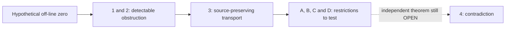

# Zeta23 / RHRC: formal mathematics and the search for an RH obstruction

**The Riemann Hypothesis (RH) and this programme's Step 4 remain OPEN.**
This repository contains Lean proofs, conditional reductions, counterexamples,
finite experiments and research infrastructure. Each answers a different question.

Start with the [project guide](docs/PROJECT_GUIDE.md) for the mathematics,
the [repository map](docs/REPOSITORY_MAP.md) for files and graphs, or the
[agent guide](docs/AGENT_GUIDE.md) before contributing.
The [dated current-state page](docs/CURRENT_STATE.md) identifies the active package
and evidence boundary. Check [PR #298](https://github.com/HMarcusWH/zeta-23-lean/pull/298)
for its live head and CI; this README is not a live acceptance receipt.

The latest [source-constraint extension](research/RHRC/integration/opica_round4/SOURCE_CONSTRAINTS.md)
compares the genuine source with the consequences of an off-line zero and
prices the complete finite-to-smooth approximation error. It identifies the
remaining arithmetic estimate; it does not establish that estimate or close RH.

Historical Control-v2 snapshot: frozen PR #287 scope

This preserved machine block is a historical receipt, not current PR routing.

<!-- RHRC_CURRENT_STATE_BEGIN -->
## Current RHRC state

THEOREM AUTHORITY
- merged theorem authority = PR #287
- validated final head = 40495f39b7510b49a7fe3493b42d9fe3880d6d22
- merge commit = ecc6450f28eb6aed944bda8fe9a09296d033fc3e
- tree = a105ffd52c96cd0c39712dcdba45e967282efc9d
- status = MERGED_GREEN_THEOREM_STATE
- PR #275 full-space small-aperture coercive base = PROVED
- PR #276 exact legal successor ground >= 1 on 0 < L <= 1/512 = PROVED
- fixed-N production continuity = PROVED_MERGED_PR_278
- same-N off-line-zero contact = PROVED_MERGED_PR_278
- PR #284 compressed contact calculus = PROVED_MERGED_PR_284_C2_AND_INHERITED_FIRST_VARIATION; F04_PAIR_BALANCE_AND_FRONTIER_PROMOTED_AFTER_MERGED_PR_287
- PR #285 post-284 source-inertia package = PROVED_MERGED_PR_285
- PR #287 post-285 M70-M77 build = PROVED_MERGED_PR_287
- PR #272 CofinalCanonicalArithmeticCertificates <-> Mathlib RiemannHypothesis = PROVED / AUDIT-ONLY
- RH = OPEN

CURRENT RESEARCH FRONTIER
- current candidate PR = #NONE / NO_OPEN_CANDIDATE_PR
- candidate theorem-validation head = NONE
- candidate theorem-validation status = NONE
- merged experimental research evidence = PR #273 / CERTIFIED_CURRENT_PRIME_GROUND_RESPONSE
- fixed-N sign opposition = PROVED_MERGED_PR_277
- global ground propagation strength = RH_SUFFICIENT_AUDIT_PROVED_PR_277
- uniform domination strength = RH_SUFFICIENT_AUDIT_PROVED_PR_277
- active obstruction = OBS-060_GROUND_SPECTRUM_FIRST_CROSSING_BARRIER
- active subobligation = OBS-060O_CONTACT_CONDITIONED_PRODUCTION_SATURATION_EXCLUSION
- F04 production derivative authority = PROVED_MERGED_PR_287
- M74 canonical secular instantiation = PROVED_MERGED_PR_287
- next research target = POST285_CANONICAL_SECULAR_RAY_PRIME_FREE_F04_AND_FULL_ARITHMETIC_SOURCE_INEQUALITY
- required new information = INDEPENDENT_FULL_ARITHMETIC_SOURCE_RESTRICTION_ON_THE_RESOLVENT_SELECTED_CONTACT_RAY
- RH-sufficient terminal formulations are not counted as independent sub-RH progress

FRAMEWORK / GRAPH STATE
- PR #270 = FFBBP 1.7 / OoL-MVS 2.7.7 framework architecture authority
- post-#276 exactified source-only theorem/lemma roots = 711
- post-#276 FFBBP source-only module cohorts = 212
- post-#276 OoL theorem-value-erased frontier contacts = 522
- post-#276 RHKG relations = 311826
- framework output -> Lean theorem authority = FORBIDDEN

RESEARCH / CONTROL FIREWALL
- latest independent bounded research evidence = PR #223
- merged first-contact atlas evidence = PR #273 / EXPERIMENTAL_SIGNAL_ONLY
- frozen Control-v2 semantic authority = PR #117
- selected formal first break = E4A4-SCHUR-FB-05 (historical/frozen control semantics)
- R003 phase = DISCOVERY
- confirmatory execution = NOT AUTHORIZED
- terminal claim = RH_OPEN
<!-- RHRC_CURRENT_STATE_END -->

<!-- OPICA_AGENT_NAVIGATION_2026_10_22 -->
## What this project is

RH says that every nontrivial zero of the Riemann zeta function lies on the
critical line, with real part `1/2`. Our research starts by supposing there is
an actual zero away from that line and asking what it would force.
The goal is to prove an independent property of the actual zeta construction
that contradicts those forced consequences.

The repository builds on [Anthropic's Zeta23](https://github.com/anthropics/zeta-23-lean).
Its upstream project formalizes the paper *More than two thirds of the zeros of
the Riemann zeta function are simple and on the critical line*.
That result and the fork's RH programme have different scopes. Read the retained
[upstream README](UPSTREAM_README.md), [upstream audit](UPSTREAM_AUDIT.md),
[license](LICENSE) and [notice](NOTICE) for attribution and original provenance.
The fork's development is recorded in [FORK_NOTES.md](FORK_NOTES.md),
[AUDIT.md](AUDIT.md) and the guide's [history](docs/PROJECT_GUIDE.md#how-the-opica-layers-fit-together).

## The four mathematical steps

| Step | Purpose | What the result does not supply |
| --- | --- | --- |
| **1. Fingerprint** | Turn a hypothetical off-line zero into a sign-sensitive obstruction, retaining its source and multiplicity. | A restriction excluding that zero. |
| **2. No-hide** | Produce canonical witnesses at suitable scales; the obstruction cannot escape every detector. | Positivity of every detector. |
| **3. Synchronized tracking** | Preserve the same source lineage through states, transforms, jets, fields and observations. | An independent bound on those objects. |
| **4. Independent contradiction** | Prove a source-matched restriction incompatible with the obstruction. | This closing mathematics is still OPEN. |

A negative quadratic form, a pole, a nonzero jet and a failed approximation can
encode the same obstruction. Moving between them does not by itself exclude it.
An RH-equivalent criterion is useful, but proving the equivalence does not prove
its positivity or convergence premise. The [worked example](docs/PROJECT_GUIDE.md)
traces the actual source, common aperture and cutoff through the even/odd contact
case split and identifies the missing opposing inequality.

## Four paths to Step 4

These are the **modern Paths A–D**. Historical CI tracks, Pair A–D, old route
letters and continuation stages use different numbering; use the
[terminology crosswalk](docs/MATHEMATICAL_GLOSSARY.md).

| Path | Mathematical route | Missing independent information |
| --- | --- | --- |
| **A — complete signed observation** | Recover the obstruction through arithmetic observations without losing its sign. | A bound or recovery-cost comparison retaining masks, collisions, mixed terms and repeated prime products. |
| **B — causal approximation** | Approximate the actual causal target `v` by completed-source dictionary outputs, with the required coefficients and whole-line residual control. | Prove the source-specific residual tends to zero; approximating the source `jPlus` itself or proving finite Gram identities does not establish this limit. |
| **C — contact / detector energy** | Use continuous contact geometry or the original detector's quantitative energy. | A matching bound on the full source and complementary energy, with correct growth and normalization. |
| **D — pole-neutral parity geometry** | Force simultaneous even/odd negativity and study the first bad contact. | Exclude it using actual source arithmetic, the physical metric, full complement and singular/shared-ground cases. |

The paths can interact. Geometry can select a ray for an arithmetic estimate;
an observation theorem can price what a projection lost; an approximation
theorem can constrain the same source in another representation. A composition
must retain the same source, quantifiers, carriers and costs. The
[guide](docs/PROJECT_GUIDE.md) distinguishes useful combinations from merely
restating RH in another form.

## OPICA and its rounds

**OPICA** means **Obstruction-Preservation and Independent-Constraint
Architecture**. It records what survives a transformation, what becomes
invisible, and which independently justified constraints can be combined.

| Package | Contribution | Where to read |
| --- | --- | --- |
| Original OPICA | Local residues, jets, transformations, energy, source adapters and counterexamples. | [Original package](research/RHRC/integration/opica/README.md) |
| Native follow-up | A source-bound theorem programme with 100 original roots and 28 acceptance units; historical and narrow receipts remain distinct from full release acceptance. | [Follow-up and Stage 22 ledger](research/RHRC/integration/opica_followup/README.md) |
| Round 2 | Research contracts, obstruction transport, source-faithful causal/observation interfaces and countermodels. | [Round 2](research/RHRC/integration/opica_round2/README.md) |
| Round 3 | Pole-neutral overlap and first-bad structure, D01–D05, finite arithmetic probes, atlas and falsification gates. | [Round 3](research/RHRC/integration/opica_round3/README.md) |
| Round 4 | Governed theorem composition, independent checking, additional signed-source/spectral support and finite research probes. | [Round 4](research/RHRC/integration/opica_round4/README.md) and [integration handover](research/RHRC/integration/opica_round4/INTEGRATION_HANDOVER.md) |

These package rounds are different from the four mathematical steps above.
Round 4 supplies checked support and tools for investigating Step 4; it does
not supply an independent closing estimate or a proof of RH. Its current
[closure obligations](research/RHRC/integration/opica_round4/CLOSURE_OBLIGATIONS.json)
retain the alternative routes and unresolved regular-cell/shared-ground cases.

## What the frameworks do

| Framework | Role here | Boundary |
| --- | --- | --- |
| **RHKG** | Map files, imports, declarations, claims, dependencies and research contacts. | A graph contact or common dependency is not a mathematical implication. |
| **FFBBP** | Typed assurance and separate source, kernel, axiom and independently reconstructed type checks. | Passing infrastructure checks cannot promote an OPEN mathematical claim. |
| **OoL-MVS** | Exact context/witness ports, compatibility checks and governed composition records. | A valid certificate is not an RH proof. |
| **Permansson** | Formal trajectory-law machinery plus a separately pinned finite control provider for the runtime. | Host and provider Lean objects stay separate; finite-menu fairness is not global proof-search optimality. |

The [framework guide](docs/FRAMEWORKS.md) explains these distinct surfaces,
versions, pipelines and exact boundaries. The
[governed runner](research/RHRC/integration/opica_composition/README.md) proposes
bounded compositions; Lean and an independent consumer must accept the full
statement. A resource stop says that a budget ended, not that no proof exists.

## How to read a result

| Label | Meaning |
| --- | --- |
| **PROVED** | The exact Lean statement passed its stated compiler and validation gates. Read its hypotheses and source scope. |
| **DERIVED** | A straightforward mathematical consequence not yet separately formalized. |
| **EXPERIMENTAL SIGNAL** | A numerical, finite-search or discovery observation within its recorded domain. |
| **LEAD / HYPOTHESIS** | A proposed route requiring proof and falsification. |
| **OPEN** | Not established, including the independent Step 4 premises. |

A green regression preserves its historical result. It does not turn an old
numerical signal into a theorem. Missing, skipped, stale or pending evidence
does not count as a passed gate. Source-only declaration counts are discovery
inventory, not theorem authority. See the [evidence policy](research/RHRC/DOCUMENTATION_AUTHORITY.md).

Failed approaches are part of the mathematical record. Generic rank-one
positivity, a source-only kernel cancellation and finite Grams implying a zero
limiting residual all have recorded countercontrols. Reopening a route requires
identifying which missing source-specific premise changed. A green replay may
preserve a falsification; read the [failure lessons](docs/PROJECT_GUIDE.md#what-failed-and-what-would-justify-reopening-it).

## Choose a reading path

- **New reader or mathematician:** [project guide](docs/PROJECT_GUIDE.md),
  [glossary](docs/MATHEMATICAL_GLOSSARY.md), then the relevant package's exact
  declarations, contracts and open obligations.
- **Developer:** [repository map](docs/REPOSITORY_MAP.md),
  [current-state snapshot](docs/CURRENT_STATE.md),
  [runner guide](research/RHRC/integration/opica_composition/README.md), then the
  relevant workflow and acceptance inventory.
- **AI agent or contributor:** [AGENTS.md](AGENTS.md),
  [agent guide](docs/AGENT_GUIDE.md), the live PR head, and the source-bound
  receipts before changing any code or claims.
- **Research reviewer:** the guide's failure lessons,
  [countermodels](research/RHRC/countermodels/README.md),
  [Round 4 contracts](research/RHRC/integration/opica_round4/MATH_CONTRACTS.json)
  and [remaining closure alternatives](research/RHRC/integration/opica_round4/CLOSURE_OBLIGATIONS.json).

## Files, graphs and reproducibility

The [repository map](docs/REPOSITORY_MAP.md) connects the Lean tree, research
records, theorem inventories, graph exports, assurance products and workflows.
The [graph guide](research/RHRC/graph/README.md) explains each view and its edge
semantics; read it before treating a diagram as an implication chain.
The same canonical machine records support both human navigation and agents.

Compiler pins live in [lean-toolchain](lean-toolchain) and
[lake-manifest.json](lake-manifest.json). Use compatible caches and the exact
workflow for the package being tested. The
[agent guide](docs/AGENT_GUIDE.md) explains narrow checks, generated-state
refresh, historical replay and the stricter production acceptance boundary.
The Round 4 aggregate independently requires all eleven lane bundles.
Older workflows retain their own historical scopes and remain separate.

When a result becomes green, inspect its proof, assumptions and every workflow's
scientific disposition. Ask which open obligation became smaller and try to
falsify promising deductions before extending the theorem programme.
The [open research records](research/RHRC/integration/opica_round3/OPEN_RESEARCH.json)
and Round 4 closure register identify what still needs new mathematics.

Historical documents remain available with explicit checkpoint labels. The
[pre-polish README](https://github.com/HMarcusWH/zeta-23-lean/blob/bd95b5b5c2448c4da042702adcb6ba221c03415a/README.md)
preserves the earlier chronological landing page. Its old “current” headings
must be read at their original dates, not as the live status of this branch.
