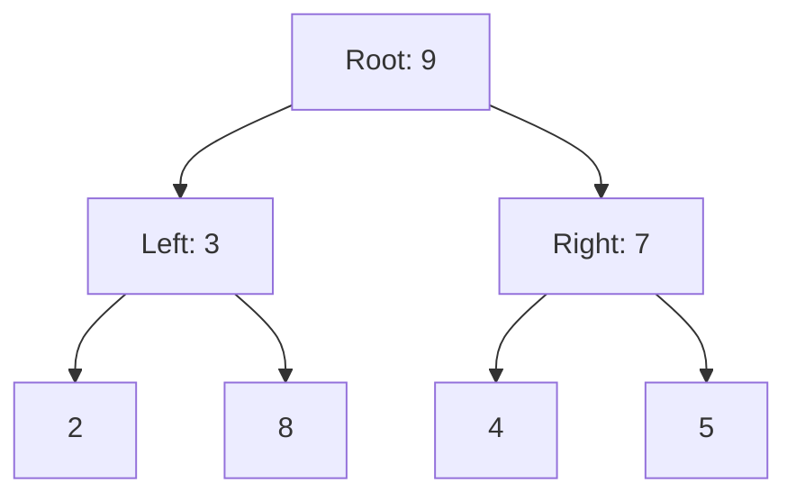

# Worked examples

These examples show how to use a result, inspect a conditional output and read a
research tool's evidence. The first four use tiny finite objects. The fifth
connects exact arithmetic to the actual native filtered certificate. The last
two explain the Step 1–3 packet and run a bounded infrastructure query.

The research baseline is [commit 7597acd](https://github.com/HMarcusWH/zeta-23-lean/tree/7597acdba0c7d0a81b8c3a5f229598e3f9b74ac9).
**RH, Step 4 and the independent closing inequalities remain OPEN.** See the
[result crosswalk](RESULTS_AND_FORMALIZATION.md) for theorem and manuscript status,
and [reproduction guide](REPRODUCIBILITY.md) for compiler and receipt scopes.

## Run the small examples

From the repository root, with Python 3.10 or newer:

```sh
python -B docs/examples/exact_examples.py
python -B docs/examples/infrastructure_replay.py
```

Both scripts use the standard library. They print JSON and write no research
products. Rational numbers are exact fraction strings; no floating-point
eigenvalue tests decide the examples. The checks remain active with `python -O`.
These commands were run with Python 3.12.14 during the documentation update.
No Lean compiler was available in that environment, so the Lean commands and
fenced consumer below are reproduction instructions, not new compilation receipts.

| Example | What it teaches | Executable or source walkthrough |
|---|---|---|
| [Negative Gram witness](#gram-witness) | Construct an explicit negative vector and see background masking | Exact Python |
| [Singular Schur step](#singular-schur) | Keep the predecessor kernel and range condition | Exact Python |
| [Positivity certificate](#positivity-certificate) | Check a positive shift and a Frobenius residual | Exact Python; optional Lean consumer |
| [Stopping tree](#stopping-tree) | A complete cover, a high path and delayed eligibility | Exact Python |
| [Raw and filtered residual](#raw-filtered) | Follow the same source and coefficients through different observables | Exact arithmetic plus theorem/manuscript walkthrough |
| [Step 1–3 packet](#step123-packet) | Read a conditional existence theorem without assuming the closing estimate | Source walkthrough |
| [Infrastructure replay](#infrastructure-replay) | Query stored open premises and select a bounded action | Existing Python components |

<a id="gram-witness"></a>
## 1. A negative Gram witness and a masking background

For real vectors $x,y$, set

$$
M=c(xx^{\mathsf T}-yy^{\mathsf T}),\qquad
\Delta=(x\cdot x)(y\cdot y)-(x\cdot y)^2,\qquad
w=(x\cdot x)y-(x\cdot y)x.
$$

Then $w^{\mathsf T}Mw=-c\Delta^2$. This gives a negative direction when
$c>0$ and the Gram determinant is nonzero. It avoids division, including an
unstated inverse of $x\cdot x$. The project's complex-coordinate theorem
requires `star x = x` and `star y = y`, so the displayed real-vector example
preserves those hypotheses.

```sh
python -B docs/examples/exact_examples.py --example gram-witness
```

The inputs $x=(1,0)$, $y=(1,1)$, $c=2$ give

$$
M=\begin{pmatrix}0&-2\\-2&-2\end{pmatrix},\quad
w=(0,1),\quad\Delta=1,\quad w^{\mathsf T}Mw=-2.
$$

Now add the positive background $5I$. The full matrix is
$\left(\begin{smallmatrix}5&-2\\-2&3\end{smallmatrix}\right)$, with first
principal minor $5>0$, determinant $11>0$, and energy $3$ at the same vector.
It is positive definite. A negative exceptional contribution therefore does not
force the sum with an uncontrolled positive background to be negative.

**Source:** [ProbeGramNegativity.lean](../Zeta23/ExceptionalZero/ProbeGramNegativity.lean),
namespace `Zeta23.ExceptionalZero`, declarations `pairBlock`, `gramDet`,
`orthoWitness`, `dotProduct_pairBlock_orthoWitness` and
`dotProduct_pairBlock_orthoWitness_neg`. The illustration is a finite matrix
calculation; applying it to the repository's actual zero contribution requires
the separate source identification and background estimates.

<a id="singular-schur"></a>
## 2. A singular predecessor: regular and resonant coupling

A bordered symmetric matrix can be written

$$
T=\begin{pmatrix}A&b\\b^{\mathsf T}&a\end{pmatrix}.
$$

The familiar expression $a-b^{\mathsf T}A^{-1}b$ is unavailable when $A$
is singular. The repository instead works with a response in the orthogonal
complement of the kernel, and requires $b\in\operatorname{range}(A)$ for that
regular case. Symmetry makes this equivalent to the coupling having zero kernel
projection. A coupling into the kernel is a distinct, resonant case.

```sh
python -B docs/examples/exact_examples.py --example singular-schur
```

Use $A=\operatorname{diag}(1,0)$. The three-dimensional coordinates are the
old range coordinate $x$, the old kernel coordinate $y$, and the new shell
coordinate $t$.

| Coupling and diagonal | Exact conclusion |
|---|---|
| $b=(1,0)$, $a=2$ | The kernel-orthogonal response is $(1,0)$; the Schur scalar is $1$; the energy is $(x+t)^2+t^2\ge0$. |
| $b=(1,0)$, $a=0$ | The Schur scalar is $-1$; $(-1,0,1)$ has energy $-1$. |
| $b=(0,1)$, $a=2$ | The coupling is outside the range; $(0,-2,1)$ has energy $-2$, despite the positive new diagonal. |

In the third row the full matrix is
$\left(\begin{smallmatrix}1&0&0\\0&0&1\\0&1&2\end{smallmatrix}\right)$.
Discarding its kernel coupling would lose the negative direction. This is why
an inverse on a quotient cannot silently stand in for the full problem.

**Source:** [KernelSafeSchur.lean](../Zeta23/OPICARound3/KernelSafeSchur.lean),
namespace `Zeta23.OPICARound3`: `kernelSafeResponse`,
`kernelSafeResponse_spec`, `kernel_projection_zero_iff_range`,
`oneShell_regular_completedSquare` and `oneShell_negative_classification`.
The source treats finite-dimensional complex inner-product spaces, a symmetric
operator, an isometric predecessor embedding and an orthogonal shell; the
negative classification retains positive semidefiniteness of the predecessor.
This example uses their real-coordinate specialization.

<a id="positivity-certificate"></a>
## 3. An exact positive-form certificate

Let $A$ be an exact real matrix, $R$ a proposed factor and $\tau>0$. Write
$E=A-\tau I-RR^{\mathsf T}$. The proved finite certificate says

$$
\|E\|_F^2<\tau^2
\quad\Longrightarrow\quad
x^{\mathsf T}Ax>0\quad\text{for every }x\ne0.
$$

The residual controls the possible negative error, while $RR^{\mathsf T}$
has nonnegative quadratic form. The theorem concerns the quadratic form and
does not require symmetry of $A$; this example chooses a symmetric matrix.

```sh
python -B docs/examples/exact_examples.py --example positivity-certificate
```

Use

$$
A=\begin{pmatrix}9/4&1\\1&2\end{pmatrix},\qquad
R=\begin{pmatrix}1\\1\end{pmatrix},\qquad\tau=1.
$$

The residual is $\operatorname{diag}(1/4,0)$, so its squared Frobenius norm
is $1/16<1$. The negative control uses $A=[-1]$, $R=[0]$, $\tau=-1$.
Its residual is zero but its quadratic form at $1$ is $-1$. The positive
shift is an essential premise.

**Source:** [FiniteCertificateSoundness.lean](../Zeta23/OPICARound4/ArithmeticFrontier/FiniteCertificateSoundness.lean),
namespace `Zeta23.OPICARound4.ArithmeticFrontier.FiniteCertificateSoundness`,
declarations `posDef_of_shifted_factor`, `shifted_factor_requires_positive_shift`,
`not_nonneg_of_negative_witness` and `pencil_checkpoint_of_posDef`. This module
imports Mathlib directly, without a zeta-source premise.

An optional generic consumer makes the exact interface visible. Save it as a
temporary `.lean` file outside the tracked source inventory and run it with the
pinned project environment after building the imported module. **This snippet
has not been compiled as part of the documentation update.**

```lean
import Zeta23.OPICARound4.ArithmeticFrontier.FiniteCertificateSoundness

open Zeta23.OPICARound4.ArithmeticFrontier.FiniteCertificateSoundness
open Matrix

example {n m : Type*} [Fintype n] [Fintype m] [DecidableEq n]
    (A : Matrix n n ℝ) (R : Matrix n m ℝ) {τ : ℝ}
    (hτ : 0 < τ) (hE : froSq (A - τ • 1 - R * Rᵀ) < τ ^ 2)
    {x : n → ℝ} (hx : x ≠ 0) : 0 < quad A x := by
  exact posDef_of_shifted_factor A R hτ hE hx
```

The native enclosure bridge remains **OPEN**: the finite theorem does not prove
that an Arb ball encloses the actual transcendental source entry. Reusing the
certificate with a new source requires that separate containment argument.

<a id="stopping-tree"></a>
## 4. A complete stopping cover and a high path

A stopping cover must meet **every** root-to-leaf branch. At an eligible internal
node you may stop there, or cover both children. A delay forbids stopping at the
first specified number of internal levels. The cost of a cover is the largest
chosen node cost; its optimum obeys `min(current, max(left, right))` at an eligible
node and `max(left, right)` while stopping is delayed.

```sh
python -B docs/examples/exact_examples.py --example stopping-tree
```



With delay $0$, the optimum is $5$. The complete cut chooses the left internal
node of cost $3$, and the two right leaves of costs $4$ and $5$. At threshold
$4$, there is no complete cover: the rightmost path has costs $9,7,5$, all
strictly above $4$. Delay $1$ still permits the same cut. Delay $2$ permits
only the leaves, so the optimum rises to $8$.

The script prints the chosen cover or the high path for four cases, including
the delay-2, threshold-5 failure. It marks delayed ancestors as ineligible, so
their displayed costs are not mistaken for a stopping opportunity.

**Source:** [StoppingAlgebra.lean](../Zeta23/OPICARound6/PrimeFactorPaths/StoppingAlgebra.lean),
namespace `Zeta23.OPICARound6.PrimeFactorPaths.StoppingAlgebra`:
`Observations.value`, `Observations.canCover`, `Observations.hasHighPath`,
`Observations.value_le_iff_cover` and `Observations.no_cover_iff_highPath`.
This finite duality imports Mathlib directly. Passing from a finite tree to a
cofinal estimate on growing native arithmetic shells is a separate obligation.

<a id="raw-filtered"></a>
## 5. The same coefficients before and after the fixed filter

The native source uses scale $\sigma=1/4096$. Fix the first four coefficients
$a=(1,-1,-1,-2/3)$, whose pole moment $\sum_{n=1}^4a_n/n$ vanishes.
The filter is fixed by the source:

$$
\widehat F(z)=\frac{z+3/2}{(z+1/2)^5},\qquad
F(t)=\mathbf 1_{t\ge0}e^{-t/2}(t^3/6+t^4/24).
$$

These are `fixedFilterMultiplier` and `fixedFilterKernel` in
[FixedFilter.lean](../Zeta23/OPICARound2/FixedFilter.lean). They define a specific
causal operator; an arbitrary replacement filter would need new identities and
bounds.

```sh
python -B docs/examples/exact_examples.py --example raw-filtered
```

The script recomputes the twelve periodic cell values, their squared mean
$13/54$, the centered-prefix bound $41/54$, and the 47-cell rational sum plus
Abel-tail budget. It obtains the exact separation

$$
U=\frac{315384568453197375401}{4648566756368995059600}
<\frac{17}{250}
<L=\frac{4396431852289}{49942416588800}.
$$

The analytic link is already expressed in
[FiniteFilteredBaseline.lean](../Zeta23/OPICARound2/FiniteFilteredBaseline.lean):
`baseline_native_filtered_upper` bounds the **actual filtered native residual**
by $U$, while `filtered_rectangle_zero_witness_lower` derives the lower $L$
from a hypothetical zero in $3/4\le\operatorname{Re}s\le7/8$,
$1\le|\operatorname{Im}s|\le2$. The complete endpoint
`filtered_four_column_region_certificate` includes the resulting nonvanishing
rectangle and its reflected counterpart $1/8\le\operatorname{Re}s\le1/4$.
The validation consumers are in
[Validation/FiniteFilteredBaseline.lean](../Zeta23/OPICARound2/Validation/FiniteFilteredBaseline.lean).
The old introductory comment in the arithmetic file describes the earlier
rational-only stage; read through to these later analytic declarations.

Paper XVI studies the **unfiltered** residual for those same four coefficients.
For the zero extension of $a$, its divisor defects are

$$
d_k=\mathbf 1_{k=1}-\sum_{n\mid k}a_n,\qquad
\sum_{k=1}^{12}\frac{|d_k|^2}{k}=\frac{41521}{41580}.
$$

The pulse lower bound and this finite calculation give the manuscript consequence

$$
\|R_4(a)\|_2^2>
\frac{50852295344128}{495}>(320518)^2,\qquad
\frac{\|FR_4(a)\|_2^2}{\|R_4(a)\|_2^2}<6.605\times10^{-13}.
$$

The Python example reproduces the weighted defects, rational lower constant and
ratio comparison. Paper XVI explicitly identifies the twelve-cell specialization
and same-vector ratio as **manuscript consequences, not separately compiled
Lean declarations**. Its analytic ingredients include
`native_isolated_pulse_lower_bound` in
[TruncationControls.lean](../Zeta23/OPICARound2/TruncationControls.lean).
Arithmetic execution does not re-prove those analytic ingredients.

Read the [paper/source crosswalk](RESULTS_AND_FORMALIZATION.md) alongside Papers
XIII, XV and XVI in the [archive](../papers/README.md). Paper XIII's raw trial
returned `NO_CERTIFICATE`; Paper XV's fixed-filter regional certificate is a
different observable, and Paper XVI explains the size of that difference for
one common vector. The rectangles were already classically known to be zero-free.
This example demonstrates the native pipeline; it supplies no global RH closure.

<a id="step123-packet"></a>
## 6. Read one complete Step 1–3 output packet

Start at [Step123CompleteOutput.lean](../Zeta23/ExceptionalZero/Step123CompleteOutput.lean)
and find `exists_generatedStep123CompleteOutput` in namespace
`Zeta23.ExceptionalZero`. Its input has the following mathematical shape:

$$
\rho\text{ is a nontrivial zeta zero},\quad
0<\beta<|\operatorname{Re}\rho-1/2|,\quad
\sigma\text{ is a reversal parity},\quad R\in\mathbb R.
$$

Its conclusion is
`Nonempty (GeneratedStep123CompleteOutput ρ β σ R)`. Thus one hypothetical
off-line zero produces the actual generated output arbitrarily far along the
requested phase. This is a noncomputable existence theorem, not a command that
finds a zero or prints numerical coefficients.

Follow this reading order:

1. `GeneratedStep123CompleteOutput` stores the generated construction and its
   native information together. Inspect the fields before using a projection.
2. `.completeNative` exposes the complete native record. `.imageErrors` and
   `.forcingErrors` provide the stated error rates for that same construction.
3. `.composed` exposes the composed obstruction. The arithmetic, range and
   structural views later in the file reorganize information without supplying
   a new closing premise.
4. [Step123CompleteOutputConsumer.lean](../Zeta23/RHRC/Step123CompleteOutputConsumer.lean)
   contains the 44 native/generated typed output consumers. These are the place
   to check the concrete field interfaces, rather than inferring their meaning
   from a package count.
5. [ClosureConsumers.lean](../Zeta23/OPICARound4/ClosureConsumers.lean) states the
   additional eventual actual-ray or negative-ground closures needed by the
   contradiction route. Those independent estimates remain OPEN.

The companion `exists_eachPhase_cofinal_generatedStep123CompleteOutput` gives
cofinal output **for each phase separately**. It does not assert that both phases
use one common aperture, one common vector or one simultaneous cutoff. A later
consumer that requires any of those must prove the needed compatibility.

For a fresh check with the pinned toolchain, use the named consumer rather than
the default root build:

```sh
lake build Zeta23.RHRC.Step123CompleteOutputConsumer
lake env lean Zeta23/RHRC/Step123CompleteOutputConsumer.lean
```

These commands compile this import closure. Full release acceptance additionally
requires its registered exports, independent expected-type checks and source-bound
receipts; see [reproduction scopes](REPRODUCIBILITY.md#what-each-check-establishes).

<a id="infrastructure-replay"></a>
## 7. Query an open route and choose one finite action

```sh
python -B docs/examples/infrastructure_replay.py
```

The first part loads the committed
[CONSTRAINT_GRAPH.json](../research/RHRC/integration/opica_round6/CONSTRAINT_GRAPH.json)
and calls the real `explain` function in
[constraint_graph.py](../research/RHRC/integration/opica_round6/constraint_graph.py).
The output includes the graph's SHA-256 and returns:

```text
target: SURVIVOR_ROUTE
status: OPEN
joint open premises: ACTUAL_UPPER, PAPER_ROUTE_VALIDATION
```

This is a query of a stored product. It does not rebuild that product or establish
its source freshness. `JOINT_INPUT` means that both inputs are required;
`ALTERNATIVE_INPUT` represents separate routes; `CONTEXT_ONLY` contributes no
logical premise. The original `SOURCE_RECORD` rows preserve provenance and cannot
act as proofs. See the [full graph-check recipe](REPRODUCIBILITY.md#round-6-graph-and-finite-replays).

The second part calls the real `select_action` in
[permansson/opica_composition.py](../research/RHRC/permansson/opica_composition.py)
on a three-action documentation fixture. With the same attempt counts, budget
$2$ selects `read`, budget $5$ selects `compile`, and budget $0$ returns
`STOP / NO_FEASIBLE_ACTION`. Feasibility comes first, then the selector orders
eligible actions by least attempts, highest priority, lowest cost and action ID.
The script also checks that a strategy intervention cannot replace the target
inventory. It selects names only; it does not perform those actions.

Use `--part graph` or `--part policy` to run one part. The fixture's digest binds
the displayed menu; it is not a project source lock. A production journal must
obtain counts and menus transactionally and independently replay real evidence.
See [framework reuse requirements](FRAMEWORKS.md#reusing-a-component).

## Citation

When adapting an example, cite the particular declaration or manuscript as well
as Marcus Hermansson's repository snapshot. Preserve upstream notices for the
inherited Zeta23/Mathlib work. The repository's [CITATION.cff](../CITATION.cff) and
[citation guide](REPRODUCIBILITY.md#citation) give source and manuscript formats.
These examples are documentation additions; their successful Python execution
is not a new Lean acceptance receipt.
