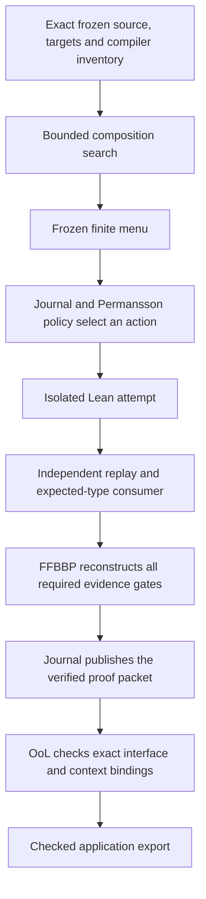
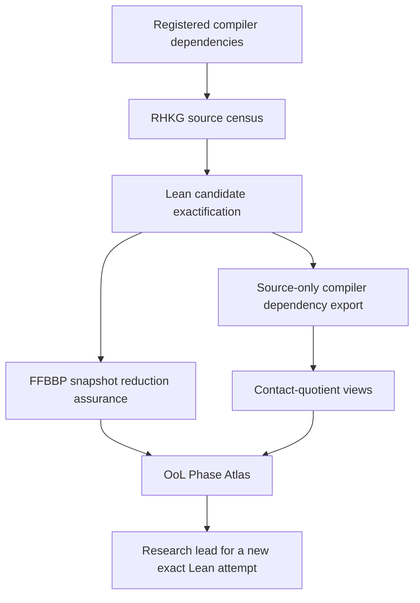

# Frameworks and governed deduction

FFBBP, OoL-MVS and Permansson help this project organize research, preserve
evidence and check how results are used. OPICA connects their bounded interfaces
to exact Lean theorem attempts. **RH, Step 4 and the independent closing
inequalities remain OPEN.**

This guide describes the implementation present at the 28 October 2026
documentation checkpoint. The linked configurations determine exact scope and
pins; a documentation page or a historical green run does not replace current
source and CI evidence. Start with the [repository guide](../README.md) for the
mathematical routes and project history.

## What each framework does here

| Component | Question it helps answer | Repository implementation |
|---|---|---|
| FFBBP typed assurance | Did the declared reduction preserve the required information, and did every required evidence gate actually pass? | [FFBBP guide](../research/RHRC/ffbbp/README.md), [OPICA adapter](../research/RHRC/ffbbp/opica_composition.py) |
| OoL-MVS operational semantics | Are evidence, premises, witnesses, phases and interface outputs bound to the same declared route and context? | [OoL guide](../research/RHRC/ool/README.md), [OPICA adapter](../research/RHRC/ool/opica_composition.py) |
| Permansson policy adapter | Which affordable action from this frozen finite menu should be attempted next, given the durable attempt history? | [Permansson guide](../research/RHRC/permansson/README.md), [selector](../research/RHRC/permansson/opica_composition.py) |
| Lean and the claim gates | Does the exact proof establish the independently specified proposition under its actual assumptions? | [governed runner](../research/RHRC/integration/opica_composition/README.md), [independent checker](../research/RHRC/integration/opica_composition/evidence.py) |

The common authority boundary is recorded in
[INTEGRATION_BOUNDARY.json](../research/RHRC/integration/INTEGRATION_BOUNDARY.json).
Only the Lean/compiler and required claim-validation gates confer mathematical
proof authority. Conditional results retain their hypotheses. Framework
agreement, graph contact and numerical agreement cannot supply a missing premise.

## The governed OPICA loop

The current runner freezes exact project, package, checker and worker identities.
It retrieves a bounded menu from compiler types and accepts a finite expression
plan. Trusted drivers elaborate and check that plan against an independently
registered target. Candidate data cannot select a different target, checker,
import policy or mathematical world.

The implementation is connected in
[service.py](../research/RHRC/integration/opica_composition/service.py).
[Journal](../research/RHRC/integration/opica_composition/journal.py) freezes menus,
records attempt counts transactionally, verifies the event chain and preserves
source generations. Its publication path repeats the independent native checker
and reconstructs four FFBBP gates: `SOURCE`, `KERNEL`, `AXIOMS` and
`INDEPENDENT_EXPECTED_TYPE`.

OoL then checks the actual dependent proof packet, exact context and witness
bindings. Different producer and consumer objects require a checked transport.
[Application records](../research/RHRC/integration/opica_composition/applications.py)
derive their ports from the native packet; callers cannot manufacture implication
by relabeling an association edge.

The Permansson adapter uses least-attempted actions first, then priority, cost
and action ID. The journal supplies the counts. This supports deterministic
selection and conditional fairness over the declared finite menu; it does not
establish globally optimal theorem search or probabilities of discovery.

Search has explicit state, depth and candidate budgets. A resource stop does
not prove a goal unprovable. An empty approved menu leaves the target OPEN.
The runner's [profile](../research/RHRC/integration/opica_composition/PROFILE.json),
[search contracts](../research/RHRC/integration/opica_composition/SEARCH_CONTRACTS.json)
and [target registry](../research/RHRC/integration/opica_composition/PUBLIC_TARGETS.json)
define the accepted scope.

## Permansson has three distinct surfaces

1. **Embedded host formalization.**
   [GeneralFramework.lean](../Zeta23/Permansson/GeneralFramework.lean) constructs
   a joint Markov kernel from the policy, physical transition and state-update
   kernels. [Theorem31.lean](../Zeta23/Permansson/Theorem31.lean) establishes the
   path-law existence-and-uniqueness statement of Theorem 3.1. This is a separate
   auxiliary formalization, checked by
   [its own workflow](../.github/workflows/permansson-formal.yml).
2. **Historical external reference.**
   [FRAMEWORK_REGISTRY.json](../research/RHRC/integration/FRAMEWORK_REGISTRY.json)
   records a v0.1.8 external snapshot at `c018f79…` with its historical
   bridge-pending scope. That entry is not the active OPICA selected-provider pin.
3. **Selected OPICA provider.**
   [FRAMEWORK_PROVIDERS.json](../research/RHRC/integration/opica_composition/FRAMEWORK_PROVIDERS.json)
   and [selected_exports.json](../research/RHRC/integration/opica_composition/providers/permansson/selected_exports.json)
   identify the active three-API selection. At this checkpoint it is commit
   `17c315f7df7abf457eb94d393bd526d46da6f6f4`, in the provider's separate Lean 4.34
   environment. The host remains pinned to Lean 4.33.0-rc2.

Those selected APIs establish executable rational value/specification agreement,
an admissible maximizing control with fixed tie breaking, and attainment of the
finite-horizon value by the computed controller. The
[provider runner](../research/RHRC/integration/opica_composition/provider.py)
rebuilds the selected source closure, compiles
[independent consumers](../research/RHRC/integration/opica_composition/providers/permansson/ProviderAudit.lean.in),
audits axioms and repeats the build independently. Provider and host compiled
objects never mix. Admission remains `POLICY_ADAPTER_ONLY`, with
`host_theorem_authority: false` and `model_optimality: NOT_ESTABLISHED`.

## The discovery graph is a separate pipeline

RHKG inventories repository objects and compiler dependencies. Its framework
products help researchers find candidates for a new proof attempt. They do not
run the governed proof loop above or establish theorem composition by reachability.

[materialize_derived_state.py](../research/RHRC/tools/materialize_derived_state.py)
owns the ordered pipeline and restores previous generated products if a producer
fails. See the [RHKG guide](../research/RHRC/graph/README.md) for graph semantics.

FFBBP's selected `MODULE_VISIBILITY_SNAPSHOT` reduction preserves declared
visibility diagnostics and source-only decisions on the exact finite snapshot.
It supplies navigation cohorts, not mathematical relevance rankings or guarantees
for future repository states. The negative module-only control tests why module
identity alone loses required information.

OoL's atlas uses `THEOREM_VALUE_ERASED_SUPPORT`: it erases theorem proof-body
value edges while retaining type and structure edges and non-theorem support
values. It removes shared support before counting interface-distinctive contact.
A surviving contact is a discovery lead; it must return to exact theorem types
and a new proof attempt.

Use the generated
[FFBBP report](../research/RHRC/ffbbp/generated/RHKG_CANDIDATE_REDUCTION_ASSURANCE.json)
and [OoL report](../research/RHRC/ool/generated/RHKG_OOL_PHASE_ATLAS.json) for their
source-bound counts and dispositions. Historical counts in older handovers
describe their named snapshots.

## Reading evidence without overstating it

- A compiled declaration proves its exact Lean statement, including every hypothesis.
- An independently checked application records one source-bound conditional application.
- A source-only declaration is absent from a registered-root dependency closure;
  that label does not establish independence, novelty or usefulness.
- A finite interval enclosure does not establish a uniform source estimate or
  exact kernel/resonance identity.
- OoL certificate `VALID` authenticates a reviewed evidence binding; its RHRC
  adapter does not certify physical or mathematical truth.
- FFBBP 1.7 assurance does not inherit the separate RUN42C synthetic runtime
  qualification or establish RUN46F execution authority.
- Repeated origins and aliases do not create independent mathematical information.

For current theorem status, follow exact-source compiler and CI evidence and the
required claim gates. For current provider scope, follow the selected-provider
configuration. For framework history, use the versioned references linked in each
framework's guide.
