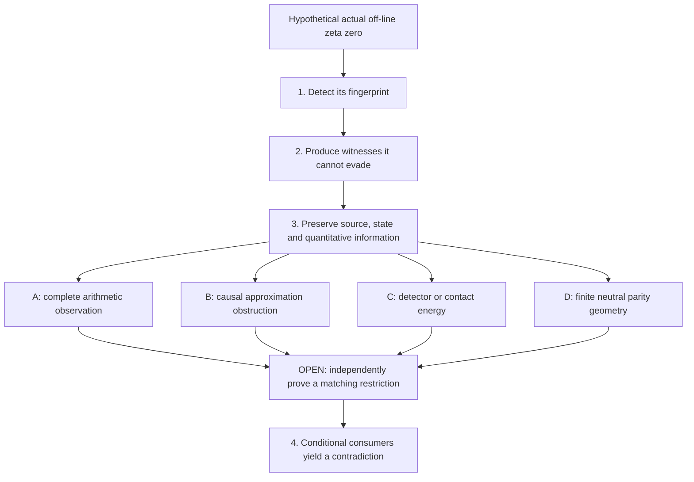

# The research programme: from a hypothetical zero to an independent contradiction

**The Riemann Hypothesis (RH) remains OPEN in this repository.** The project
contains proved supporting mathematics, conditional criteria, counterexamples
to proposed shortcuts, and finite computations. Their roles are different.

RH says that every nontrivial zero of the Riemann zeta function has real part
`1/2`. This programme asks what an actual hypothetical zero away from that line
would force, then seeks an independently proved fact that makes those forced
objects impossible. A necessary consequence of a hypothetical zero is progress
in describing the problem; it becomes a contradiction only with an opposing
theorem about the same mathematical object.

Use the [root README](../README.md) for navigation and the
[agent instructions](../AGENTS.md) before changing the repository. This guide
explains the mathematics and its history. Exact declarations and source-bound
compiler evidence control theorem claims; live workflow results control the
status of the checked commit. Historical handovers describe their own checkpoints.
The [mathematical glossary](MATHEMATICAL_GLOSSARY.md) separates modern terminology
from historical labels that reuse the same letters.

## The four steps

The project's current explanation of these steps is in the
[Round 2 research account, section 3](../research/RHRC/integration/opica_round2/paper/ROUND2_POSTGREEN_V2_1.md#3-what-steps-13-now-contribute).
The numbers describe mathematical roles, not four automatically completed tasks.

| Step | What it contributes | What remains separate |
| --- | --- | --- |
| **1. Fingerprint** | An actual off-line zero gives a detectable, sign-sensitive obstruction, retaining the original source and the zero's multiplicity. | A theorem excluding that obstruction. |
| **2. No-hide** | Canonical scales and witness-generation results prevent the hypothetical zero from escaping every detector. | Positivity of every detector or nonexistence of the zero. |
| **3. Synchronized tracking** | Follow one source lineage through the detector, finite representation, selected state, fields, transformations and quantitative observations. | An independent sign, energy or approximation estimate. |
| **4. Independent contradiction** | Prove a matching restriction that conflicts with what the zero forces. | The independent closing premises are still OPEN. |

The diagram organizes the argument. Its arrows are not a replacement for
compiler-derived dependencies or a claim that every proposed bridge is proved.

### What is actually carried through Steps 1–3?

The original source is a specific compact smooth source built from an infinite
box convolution, with fixed scale `1/4096`. Its differentiated sources,
transforms, finite detectors and causal fields have explicit definitions.
Replacing it by a convenient bump or an arbitrary negative matrix changes the
problem. See the [original source specification](../research/RHRC/integration/post290/spec/BUILD_SPEC.md#4-flagship-producer-and-correct-quantifiers)
and [current producer](../Zeta23/ExceptionalZero/Step123OutputProducer.lean).

The [complete output](../Zeta23/ExceptionalZero/Step123CompleteOutput.lean)
assembles statements about one generated packet. Given an actual zero, an
exponent strictly between zero and its horizontal displacement, a requested
phase and any lateness bound, the construction produces a sufficiently late
packet. It is noncomputable mathematical existence, not a program that finds
an off-line zero. The original producer supplies each phase separately;
their apertures need not agree.

"Same source" does not mean that every vector is equal. Finite approximation,
projection, normalization, ground selection and parity transfer can change a
vector. Each usable bridge must supply its equality, implication or error
bound. The detector, its selected ground and its causal source cannot be
interchanged merely because they arise in one packet.

The follow-up adds actual-source rate theorems. For a fixed source order and
`C > 1`, energy in the window `[T - C log T, T]` has normalized logarithmic
rate `Theta`, the actual supremum of nontrivial-zero displacement from the
critical line. The normalization is `log(1 + energy)/(2T)`.
The [fixed-source theorem](../Zeta23/OPICAFollowup/NativeWindowRate.lean) and
[slow-source extension](../Zeta23/OPICAFollowup/MovingSourceWindowRate.lean)
retain their precise domains. The moving-order schedule must satisfy
`d(T) log(d(T)+2) = o(T)`. This is not permission to vary every parameter freely.

## The modern Paths A–D

These are alternative directions for Step 4. A successful argument can combine
them, or complete one sufficient route; it does not need to solve every
alternative. The [route account](../research/RHRC/integration/opica_round2/paper/ROUND2_POSTGREEN_V2_1.md#4-the-four-live-closing-obligations)
explains their provenance. The
[Round 2 open-research register](../research/RHRC/integration/opica_round2/OPEN_RESEARCH.json)
retains the source and acceptance requirements.

### Path A: complete signed arithmetic

The target is an upper bound on the actual complete arithmetic observation.
Its signs, repeated-prime products, collision terms, masks and mixed terms
matter. The proved rate identifies the obstruction that this upper must beat.
A sufficiently quiet upper along a cofinal sequence would force `Theta = 0`.
Proving preservation of the rate supplies no such upper.

A bound on one sector of a trace cannot stand for its uncontrolled complement.
An absolute-value bound could suffice if it meets the required exponent for
the unchanged complete object. A separate observation branch seeks actual
nonnegative physical observations and an independently smaller error than the
proved negative-test margin. That branch must pay its source and recovery costs;
it is not automatically the same object as the high-energy observation.

### Path B: source-specific causal approximation

A hypothetical zero gives a positive separation from the range of a concrete
causal convolution operator. The opposing theorem would construct actual
finite approximations whose full residual tends to zero.

Keep two interfaces distinct. The original **B-Y** condition concerns the
original completed input at every positive damping. Repository Round 2 also
constructs a different undamped probe from the delayed original source:
`v = c * jPlus`, `w = a * jPlus`, and delayed dictionary columns derived from
`w`. See [CausalProbe.lean](../Zeta23/OPICARound2/CausalProbe.lean).

The [Gram/residual consumers](../Zeta23/OPICARound2/ProbeGram.lean) show that
a suitable residual limit implies RH. The
[fixed-filter consumer](../Zeta23/OPICARound2/FixedFilter.lean) gives another
sufficient approximation premise without requiring inversion of that filter.
The required sequences remain OPEN. Finite improvement, positive Gram matrices
and a successful regional certificate do not prove the global limit.

### Path C: full continuous contact and original-detector energy

One subroute retains the original detector and its entire Schur complement.
The generated family has an exponential loss lower bound. An independent
smaller upper on that same family would contradict it. A stronger uniform
all-selectors theorem is possible, but must not be mistaken for a necessary
quantifier in every argument.

The full continuous-contact nullsource/exterior-energy construction is a
distinct subroute. Its source is not identified with the original detector.
It requires its own exact energy and forcing adapters. A small inverse alone
does not control a growing forcing vector or the direct complement. The
[original conditional sufficiency theorem](../Zeta23/ExceptionalZero/Step4OutputSufficiency.lean)
keeps the missing complete-source upper explicit.

### Path D: finite pole-neutral first-negative contact

This studies the actual finite canonical Weil form on even and odd carriers
satisfying the pole-neutral constraints. A fixed seed lift gives coordinates
for moving carriers, but it is not an isometry: the positive metric and signed
energy form must both remain in the calculation.

At a first negative transition, the whole kernel, complement, parity ties,
inherited kernels and prime seams matter. A positive semidefinite first derivative can
leave uncontrolled directions on its nullspace. A finite Taylor check is not
a general theorem excluding every outgoing negative germ.

Known controls already reject geometry-only shortcuts and a proposed global
metric-compatible positive transport remainder. These are recorded in the
[Path D audit](../research/RHRC/integration/opica_round2/paper/ROUND2_POSTGREEN_V2_1.md#path-d--finite-pole-neutral-first-negative-contact).
They do not refute an independently proved restriction using the actual
arithmetic source.

### One concrete Path D argument, including its missing step

Here `L > 0` is the physical aperture and `K` is the finite Fourier cutoff.
The physical carriers are the actual even/odd finite function spaces with
their inherited inner products and boundary/pole-neutral constraints. The
complete canonical form retains the unchanged pole, Archimedean and every
active prime-power contribution. Its corrected source functional also retains
the output removed by neutral compression. A source-only fragment is a
different expression.

The even-to-odd index map `D` is invertible on the stated carriers but generally
nonunitary: it does not preserve the physical norm. Its actual adjoint supplies
the odd orientation. Neither is the embedding that changes the cutoff.
These distinctions appear in [neutral geometry](../Zeta23/CCM/CanonicalPoleNeutralGeometry.lean)
and [corrected intertwining](../Zeta23/CCM/CanonicalPoleNeutralIntertwining.lean).

1. **Assume an actual off-line zero `rho`.** Given any lateness bound `R`,
   [D02](../Zeta23/OPICARound3/CofinalSimultaneousNegative.lean) produces one
   `L > R` and one `K >= 3` with both actual parity forms negative. This uses
   the tail cover, separate cofinality, openness, connectedness and centered
   extension. Separate parity sequences alone would not supply this state.
2. **Take the actual ground energies at that same `L,K`.** In this paragraph
   only, write `alpha` for the even bottom and `beta` for the odd bottom.
   Both are negative. These names do not denote the source multiplier or the
   horizontal exponent used elsewhere. [NativeWitnessCosts.lean](../Zeta23/OPICARound4/NativeWitnessCosts.lean)
   selects genuine ground eigenmodes and proves the exhaustive alternatives.
   A D05 newborn Schur witness need not itself be an eigenvector; its full norm
   is paid before it provides a ground-energy bound.
3. **If `alpha < beta`,** the actual corrected even source on its shifted ray
   at `alpha` equals `1`. If `beta < alpha`, the actual odd pairing on its
   adjoint shifted ray at `beta` equals `1`. These are source equalities under
   the stated strict opposite-spectrum hypotheses, not independent upper bounds.
4. **The desired opposing theorem is still OPEN.** An independent restriction
   making the real part of the corresponding same-state response strictly less
   than `1` would contradict the equality. The weaker negative-ground route
   needs these comparisons only at the actual grounds; the all-ray route asks
   for them on every specified negative shift.
5. **If `alpha = beta < 0`, the strict comparisons do not apply.** A separate
   actual-source shared-negative-ground exclusion is required and remains OPEN.
   Generic source visibility or rank-one transport does not supply it.

The [closure consumer](../Zeta23/OPICARound4/ClosureConsumers.lean) formalizes
this case split. For eventual closure, its threshold is fixed before every
later aperture and cutoff. D02 then contradicts that eventual restriction.
Thus the contradiction mechanism is available conditionally; the independent
arithmetic comparisons and shared-ground exclusion are not proved by assembling it.

## Combining routes without losing the problem

There are proved bridges between some formulations. The original prime-field
L2 condition implies the original completed-input range condition through the
[literal convolution equation](../Zeta23/CCM/NativeCompletedInputRangeOfPrimeLp.lean).
More strongly, [NativeCuts.lean](../Zeta23/OPICARound2/NativeCuts.lean) proves
that the original all-damped L2/integral and all-damped range-closure conditions
are equivalent to RH. It also links `Theta = 0` and complete cofinal quietness.
An equivalence proves logical strength; it does not prove either open premise.

Useful composition must preserve the source, zero, phase, normalization,
history, aperture, cutoff and required quantifier order. It can combine a
proved lower obstruction with an independently proved upper, or transport
an estimate through a proved adapter. It cannot borrow an upper for a different
source, change witnesses between the two bounds, discard a hard mixed term,
or pass from finite composition to a limit without controlling the topology
and accumulated errors.

In particular, the raw and fixed-filter approximation limits are alternative
sufficient premises, not an asserted equivalence of residual norms. Similarly,
a one-shell or single-parity index bound cannot replace a bound on the joint
physical negative space.

## How the OPICA layers fit together

The [preserved upstream Zeta23 account](../UPSTREAM_README.md) documents formal
results on proportions of zeta zeros and their analytic foundations. This fork
adds the RH-directed programme under `CCM`, `ExceptionalZero` and `research/RHRC`.
Those upstream results are foundations, not a proof that every zero is on the line.

Before OPICA, the [post-247 programme](../research/RHRC/routes/R003_ccm_bridge/POST_247_RIEMANN_WEARING_GLASSES_PROGRAM.md)
organized spectral, carrier, source and arithmetic coordinates of one canonical
finite Weil object. Equivalent coordinates expose different useful structures
without creating information. Its historical route already isolated the missing
independent arithmetic/spectral exclusion and identified RH-equivalent targets.

**OPICA** means **Obstruction-Preservation and Independent-Constraint
Architecture**. It formalizes what transformations preserve a detectable
obstruction and what additional information a contradiction would need.
The [original construction](../research/RHRC/integration/opica/paper/OPICA_Paper_Construction_v1_0_2026-10-21.md)
separates local pole/jet information, global energy rates, observation recovery
and limiting arguments. These invariants cannot be identified by their names.

The table is a lineage map. Linked handovers and intake records establish their
own historical source/merge checkpoints; later operational status must be read
from GitHub and the exact checked receipts.

| Layer and historical PR anchor | Mathematical role | Source guide |
| --- | --- | --- |
| Step 1–3 output, [#292](https://github.com/HMarcusWH/zeta-23-lean/pull/292) | Assemble the original detector, finite image, retained state and physical/range evidence on one source lineage. | [Complete output](../Zeta23/ExceptionalZero/Step123CompleteOutput.lean) |
| Original OPICA, [#293](https://github.com/HMarcusWH/zeta-23-lean/pull/293) | Local transport, correction-aware composition, energy rates, observation and range interfaces, with countercontrols. | [Parent guide and accepted merge record](../research/RHRC/integration/opica/README.md), [parent intake](../research/RHRC/integration/opica_followup/PARENT_INTAKE.json) |
| Native follow-up, [#294](https://github.com/HMarcusWH/zeta-23-lean/pull/294) | Actual-source transforms, explicit formulae, window rates, arithmetic masks, co-Poisson measures, zero profiles/jets and force/sampling bridges. | [Continuation guide](../research/RHRC/integration/opica_followup/continuation/2026-10-22/README.md), [later intake context](../research/RHRC/integration/opica_round2/README.md) |
| Repository Round 2, [#295](https://github.com/HMarcusWH/zeta-23-lean/pull/295) | Delayed causal probe, Gram/residual analysis, fixed filtering, source-prefix error budgets and finite certificates. | [Round 2 guide](../research/RHRC/integration/opica_round2/README.md), [its recorded use as Round 3 parent](../research/RHRC/integration/opica_round3/README.md) |
| Round 3, [#297](https://github.com/HMarcusWH/zeta-23-lean/pull/297) | Simultaneous parity negativity, local negative frames, first common cutoff and regular/resonant newborn source witnesses. | [Round 3 guide](../research/RHRC/integration/opica_round3/README.md), [recorded Round 4 parent](../research/RHRC/integration/opica_composition/README.md) |
| Round 4, [#298](https://github.com/HMarcusWH/zeta-23-lean/pull/298) | Governed bounded deduction, signed spectral/source budgets, observation/index support, conditional closure consumers and independent finite probes. | [Mathematical guide](../research/RHRC/integration/opica_round4/README.md), [integration handover](../research/RHRC/integration/opica_round4/INTEGRATION_HANDOVER.md) |

These layers add reusable mathematics; later layers do not silently replace
the original contracts. The original facade, follow-up facade, later round
facades and audit/validation modules have different import roles.

### Three naming systems that must stay distinct

The follow-up paper has internal **Round 1 / Round 2** result groups. Those
groups belong to the `OPICAFollowup` paper and specification; they are not the
later repository namespace `OPICARound2`. The dated continuation **Stages** are
implementation and evidence checkpoints inside the follow-up campaign, not
new mathematical rounds or levels of progress toward RH.

Modern **Paths A–D** also differ from legacy CI **Tracks A–D**, historical
4A/4B/4C campaign labels and the October 12 requirements' track vocabulary.
In particular, a green legacy Track D job does not prove the modern Path D
no-exit target. The [taxonomy warning](../research/RHRC/integration/opica_round2/paper/ROUND2_POSTGREEN_V2_1.md#23-a-naming-trap-to-avoid)
is part of the source audit, not a cosmetic naming preference.

## What the latest layers make possible, and what remains OPEN

Round 3 strengthens separate parity cofinality to simultaneous negativity at
one aperture and cutoff, using the tail cover, openness, connectedness and
exact embeddings. It then supplies local continuous negative frames and
exhaustive regular/resonant newborn transitions. These are stronger necessary
consequences of a hypothetical zero, not contradictions. The
[Round 3 register](../research/RHRC/integration/opica_round3/OPEN_RESEARCH.json)
preserves the missing sign and limit estimates.

Round 4 selects genuine ground eigenmodes without identifying them with Schur
witnesses, retains normalization costs, groups spectral data by eigenspace,
and exposes the full arithmetic discrepancy and observation budgets. Exact
identities and bounds in terms of source costs do not independently make those
costs small. The [mathematical contracts](../research/RHRC/integration/opica_round4/MATH_CONTRACTS.json)
record proved support, partial support and open leaves separately.

The [closure consumers](../Zeta23/OPICARound4/ClosureConsumers.lean) offer
alternatives: eventual restrictions on actual resolvent rays, weaker
restrictions on actual negative grounds, or direct no-simultaneous-negativity.
The strict comparison branches require separate shared-negative-ground
exclusion. The [joint-index consumer](../Zeta23/OPICARound4/NativeJointIndex.lean)
offers another sufficient premise on the full physical negative space.
Thresholds must be chosen before the apertures and cutoffs they govern.
None of these premises has been independently established.

The regular-cell programme remains incomplete. It is one possible method,
not a prerequisite for every direct or ground-restricted route. Its unresolved
selection, nonidentity, singular, shared-ground and uniformity issues remain
visible in the [integration handover](../research/RHRC/integration/opica_round4/INTEGRATION_HANDOVER.md).

## What failed, and what would justify reopening it

Failure records identify the inference that failed and the assumptions it
preserved. A synthetic countermodel is not an actual zeta counterexample.
A logical-strength audit is different again: it can show that a proposed
"smaller lemma" already asks for all of RH.

| Proposed shortcut | Recorded obstruction | What a replacement must supply |
| --- | --- | --- |
| Geometry and positive prime-shaped data alone exclude negative contact. | The [Path D audit](../research/RHRC/integration/opica_round2/paper/ROUND2_POSTGREEN_V2_1.md#path-d--finite-pole-neutral-first-negative-contact) retains a coherent modified-prime crossing. Round 4 also labels its [modified-q2 probe](../research/RHRC/integration/opica_round4/source_evaluator.py) explicitly non-zeta. | A property of the unchanged actual arithmetic, absent from the modified control. |
| Nonunitary rank-one intertwining is a positive Hermitian rank-one update. | `NONUNITARY_PSD_RANKONE_FALSE` in the [exact control register](../research/RHRC/integration/opica_round4/COUNTERMODEL_REGISTER.json) preserves Hermitian operators and invertible transfer but defeats that inference. | Retain the actual metric, adjoint orientation and signed terms. |
| Corrected source alone has zero opposite-kernel projection on a newborn witness. | The [same-newborn rational control](../research/RHRC/integration/opica_round3/tests/test_source_evaluator.py) makes only the whole transferred operator-output-plus-source expression compatible. | Keep the complete output, or separately prove a condition that removes it. |
| Positive finite Grams, decreasing errors or strong residual convergence imply residual zero. | `STRONG_LIMIT_NONZERO` in the [executable control bank](../research/RHRC/integration/opica_composition/countermodels.py) converges to a nonzero residual. The [Round 2 registry](../research/RHRC/integration/opica_round2/CONTROL_REGISTRY.json) retains stationary-residual and finite-limit warnings. | An actual zero-limit estimate, not convergence to an unspecified projection. |
| Transfer data or a positive observed measure sees every negative ground. | `SHARED_INVISIBLE_NEGATIVE_GROUND` and `HERGLOTZ_INVISIBLE_NEGATIVE_GROUND` in the [control register](../research/RHRC/integration/opica_round4/COUNTERMODEL_REGISTER.json) retain a negative mode invisible to that observation. | A source-specific visibility or shared-ground exclusion theorem. |
| Renaming an equivalent terminal condition makes it independent sub-RH progress. | [NativeCuts.lean](../Zeta23/OPICARound2/NativeCuts.lean) and the [post-247 audit](../research/RHRC/HISTORICAL_ROUTE_AUDIT_POST_247_RECONCILIATION.md) expose exact RH-strength conditions. | A genuinely proved new input; an equivalence alone establishes no closing premise. |

An unobserved eigenmode stays unobserved under its iterates; an arbitrary
vector in an instantaneous observation kernel need not. The control bank
preserves this distinction too. Do not turn a scoped invisibility result into
a statement about every vector in the kernel.

The [dead-route ledger](../research/RHRC/DEAD_ROUTES.md) requires a revival to
identify which blocking premise changed and why the change matters. The
[post-247 reconciliation](../research/RHRC/HISTORICAL_ROUTE_AUDIT_POST_247_RECONCILIATION.md)
illustrates a legitimate narrowing: global monotonicity remained false, while
local contact/seam reasoning became worth revisiting with stronger interfaces.
Rerunning a counterexample without changing its mathematical premise is not
that kind of revival.

## Where further information would matter

The existing work points to concrete open tasks: a complete signed arithmetic
upper, a genuine raw or fixed-filter approximation limit, a source-matched
detector/contact energy upper, or an actual-source restriction excluding the
finite negative configurations. Round 4's discrepancy formula makes the joint
arithmetic, variation and inverse-gap costs explicit. A bound for an externally
fixed test cannot be substituted for that selected moving family.

These are research directions already identified by the project, not new
claims from this guide. Consult the [closure-obligation register](../research/RHRC/integration/opica_round4/CLOSURE_OBLIGATIONS.json)
and [post-green record](../research/RHRC/integration/opica_round4/POST_GREEN_RESEARCH.json)
before choosing a theorem target. Preserve the known countermodels and test
any proposed restriction on boundary, shared-ground and modified-source cases.

For both readers and agents, the decisive distinction is the exact statement:
**PROVED** requires its checked declaration and dependencies; **DERIVED** is a
stated consequence awaiting its own formalization; **LEAD / HYPOTHESIS** is a
route to investigate; **EXPERIMENTAL SIGNAL** is scoped numerical evidence;
**OPEN** is not established. Supporting proof, finite certification, complete
release acceptance and independent review each need their own evidence.
