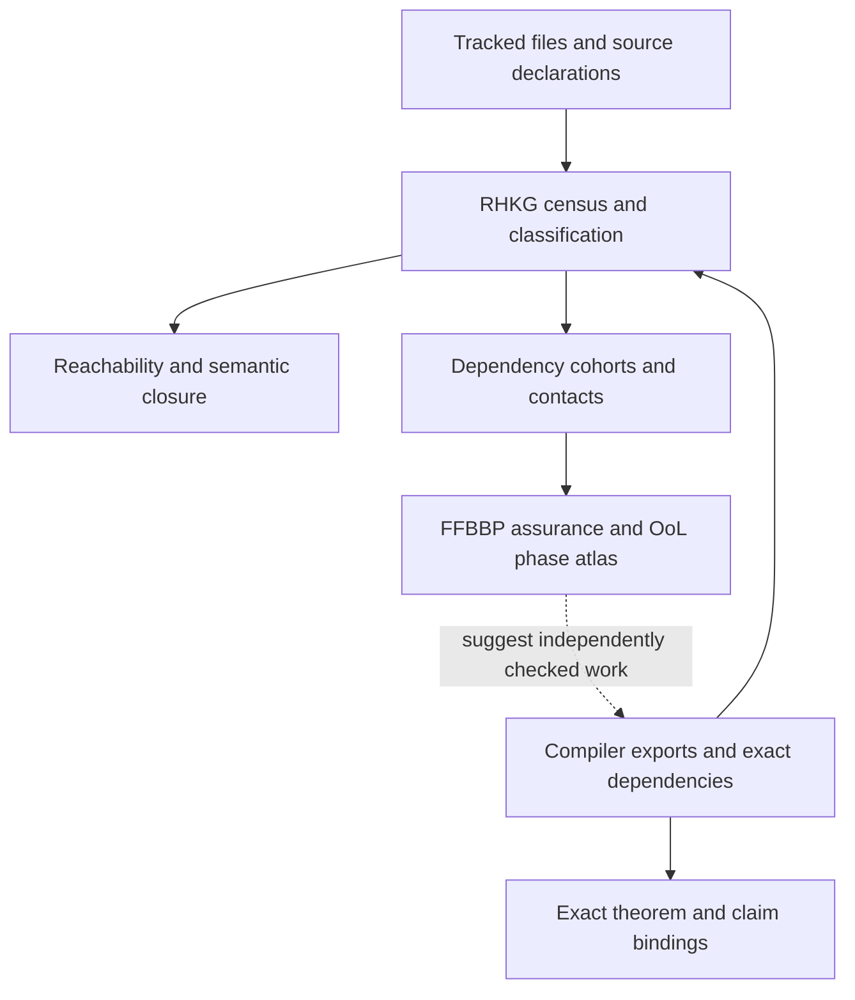

# Repository map and graph reading guide

Use the [README](../README.md) for the overview, the
[current snapshot](CURRENT_STATE.md) for source scope and the
[project guide](PROJECT_GUIDE.md) for the mathematics. This map points people
and agents to the same records rather than maintaining a second theorem ledger.

## Where the work lives

| Area | Contents and entry point |
| --- | --- |
| Upstream theorem package | [Upstream README](../UPSTREAM_README.md), [audit](../UPSTREAM_AUDIT.md), `Zeta23/`, [ChallengeDeps.lean](../comparator/ChallengeDeps.lean) and [Solution.lean](../comparator/Solution.lean). Read provenance before attributing a theorem to the fork. |
| Formal RH programme | `Zeta23/CCM/`, `Zeta23/ExceptionalZero/`, `Zeta23/OPICA/`, `Zeta23/OPICAFollowup/`, `Zeta23/OPICARound2/`, `Zeta23/OPICARound3/`, `Zeta23/OPICARound4/`; package registers identify the exact exported declarations. |
| Research control/history | [RHRC](../research/RHRC/README.md), [authority policy](../research/RHRC/DOCUMENTATION_AUTHORITY.md), route READMEs, dated deltas, [dead routes](../research/RHRC/DEAD_ROUTES.md) and [countermodels](../research/RHRC/countermodels/README.md). |
| Integration packages | [Package index](../research/RHRC/integration/README.md), [Round 4](../research/RHRC/integration/opica_round4/README.md), [runtime](../research/RHRC/integration/opica_composition/README.md), contracts, inventories and OPEN obligations. |
| Frameworks | [Framework guide](FRAMEWORKS.md), [FFBBP](../research/RHRC/ffbbp/README.md), [OoL](../research/RHRC/ool/README.md), [Permansson](../research/RHRC/permansson/README.md). |
| Derived graph | [RHKG guide](../research/RHRC/graph/README.md), its [constitution](../research/RHRC/graph/CONSTITUTION.md), [contract](../research/RHRC/graph/GRAPH_CONTRACT.md) and generated records. |
| Validation | [Workflow definitions](../.github/workflows/), exact-source receipts, declared acceptance matrices and [agent guide](AGENT_GUIDE.md). |

## Graphs: choose the question first

This is a data-flow map. It does not assert that graph proximity proves a theorem.
Read edge kinds and provenance: an import, a compiler constant use, a document
reference, a projection overlap and a reviewed mathematical implication differ.

| Question | Canonical record | What it establishes |
| --- | --- | --- |
| Which files were counted/classified? | [REPOSITORY_COVERAGE](../research/RHRC/graph/generated/REPOSITORY_COVERAGE.json) | Tracked-file census and coverage in the recorded source scope. |
| Which module is reachable from an entry point? | [ENTRYPOINT_REACHABILITY](../research/RHRC/graph/generated/ENTRYPOINT_REACHABILITY.json) | Import reachability, not a claim that every declaration was freshly compiled. |
| Which proved registered claim binds to which theorem? | [THEOREM_CLAIM_MAP](../research/RHRC/graph/generated/THEOREM_CLAIM_MAP.json) | Exact registered binding within its manifest and compiler receipt. |
| What does a registered theorem use? | [THEOREM_DEPENDENCY_CLOSURE](../research/RHRC/graph/generated/THEOREM_DEPENDENCY_CLOSURE.json) | Compiler dependency closure in the recorded extraction scope. |
| Are modules/documents semantically accounted for? | [MODULE_SEMANTIC_CLOSURE](../research/RHRC/graph/generated/MODULE_SEMANTIC_CLOSURE.json), [DOCUMENT_SEMANTIC_CLOSURE](../research/RHRC/graph/generated/DOCUMENT_SEMANTIC_CLOSURE.json) | Classification/accounting, not theorem promotion. |
| Which dependency kernels or cohorts overlap? | [DEPENDENCY_KERNEL_ATLAS](../research/RHRC/graph/generated/DEPENDENCY_KERNEL_ATLAS.json), [DEPENDENCY_COHORT_OVERLAP](../research/RHRC/graph/generated/DEPENDENCY_COHORT_OVERLAP.json) | Shared structure useful for research triage; overlap is not independent mathematical information. |
| Which projected frontiers/contact candidates appear? | [DEPENDENCY_PROJECTION_FRONTIERS](../research/RHRC/graph/generated/DEPENDENCY_PROJECTION_FRONTIERS.json), [contact quotient guide](../research/RHRC/routes/R003_ccm_bridge/contact_quotient/README.md), [CONTACT_QUOTIENT_VIEW](../research/RHRC/graph/generated/CONTACT_QUOTIENT_VIEW.json) | Projection/contact records retaining source-only and unreviewed dispositions. |
| What typed assurance was attached? | [FFBBP assurance](../research/RHRC/ffbbp/generated/RHKG_CANDIDATE_REDUCTION_ASSURANCE.json) | Governed evidence about the checked object and allowed claim cap. |
| What contextual ports can be composed? | [OoL phase atlas](../research/RHRC/ool/generated/RHKG_OOL_PHASE_ATLAS.json) | Typed context/witness and phase records, requiring separate mathematical validation. |
| How did the old follow-up programme fit together? | [Manual follow-up map](../research/RHRC/graph/OPICA_FOLLOWUP_CURRENT_STATE.md) | A scoped human navigation diagram for the original 100-root package. |

Generated JSON/JSONL files are the inspectable data behind these views. Their
presence in Git is not a fresh receipt for the current checkout. Follow the
producer, source hash, compiler scope and disposition fields. Source-only census
entries may be valuable leads but have no registered theorem authority.

## Tests and CI: several different questions

Round 4's [composition workflow](../.github/workflows/rhrc_opica_composition.yml)
and [acceptance matrix](../research/RHRC/integration/opica_round4/ACCEPTANCE_MATRIX.json)
bind eleven lane bundles and a separate independent aggregate. Read the
[runtime guide](../research/RHRC/integration/opica_composition/README.md)
for production isolation and publication checks.

Classify each job by what it actually establishes:

- **Formal validity gate:** fresh compilation, exact type/axiom/placeholder checks.
- **Regression gate:** preserve a historical theorem, countermodel, certificate or receipt within its original source scope.
- **Research-producing check:** compute finite information whose actual scientific disposition must be read.
- **Completeness/aggregation gate:** require the declared lane set and reconcile source/run identities; it cannot supply missing mathematical evidence.

Old OPICA, continuation, Round 2/3 and diagnostic workflows deliberately keep
frozen selectors. A historical parent replay passing does not validate every
new child declaration. Conversely, an explicitly historical selector should
not be expanded casually to absorb a new child package.

## Rebuilding derived views

The canonical transaction is
[materialize_derived_state.py](../research/RHRC/tools/materialize_derived_state.py).
It orders compiler extraction, RHKG, source exactification, FFBBP, contact and
OoL production and restores generated state if a later producer fails.
Use the compatible pinned Lean environment and read the workflow before running
a broad refresh. Do not hand-edit generated JSON to make validation pass.

Source-scope manifests must include new authored files before their graph census
is rebuilt. A historical-native render replay is useful local structural evidence;
it must be labelled separately from fresh compiler qualification. The
[agent guide](AGENT_GUIDE.md) gives the workflow for safe, reviewable extensions.
