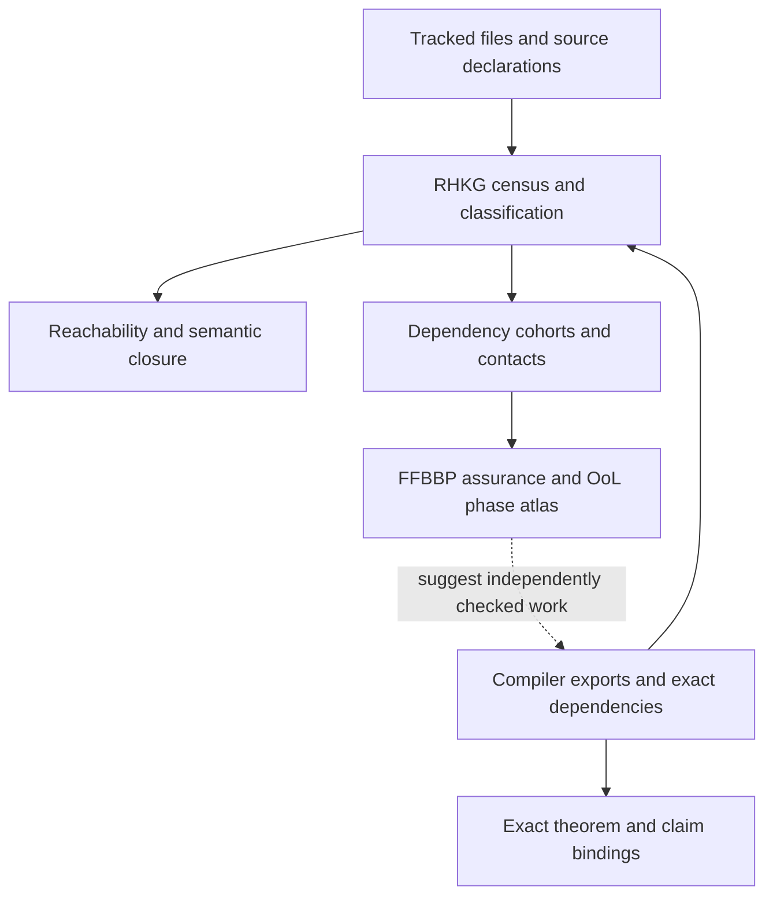

# Repository map and graph reading guide

Use the [README](../README.md) for the overview, the
[21 November snapshot](CURRENT_STATE.md) for source scope and the
[project guide](PROJECT_GUIDE.md) for the mathematics. To select a result by task,
use [reusable components](REUSABLE_COMPONENTS.md); to map a paper to source and
evidence, use [results and formalization](RESULTS_AND_FORMALIZATION.md). This map points people
and agents to the same records rather than maintaining a second theorem ledger.

## Where the work lives

| Area | Contents and entry point |
| --- | --- |
| Upstream theorem package | [Upstream README](../UPSTREAM_README.md), [audit](../UPSTREAM_AUDIT.md), `Zeta23/`, [ChallengeDeps.lean](../comparator/ChallengeDeps.lean) and [Solution.lean](../comparator/Solution.lean). Read provenance before attributing a theorem to the fork. |
| Canonical finite and exceptional-zero programme | [CCM](../Zeta23/CCM), [ExceptionalZero](../Zeta23/ExceptionalZero) and the [complete Step 1–3 consumer](../Zeta23/RHRC/Step123CompleteOutputConsumer.lean); exact forms, source adapters, finite detectors, contact/parity calculus and packet construction. |
| OPICA through Round 4 | [OPICA](../Zeta23/OPICA), [OPICAFollowup](../Zeta23/OPICAFollowup), [Round 2](../Zeta23/OPICARound2), [Round 3](../Zeta23/OPICARound3), [Round 4](../Zeta23/OPICARound4); package registers identify exact declarations and consumers. |
| November arithmetic frontier | [Package guide](../research/RHRC/integration/opica_round4/arithmetic_frontier/README.md), [Lean modules](../Zeta23/OPICARound4/ArithmeticFrontier), [build specification](../research/RHRC/integration/opica_round4/arithmetic_frontier/BUILD_SPEC.md) and [12 November handover](../research/RHRC/integration/opica_round4/arithmetic_frontier/HANDOVER_2026-11-12.md); moment slices, certificates, rate bounds and their logical strength. |
| Round 5 parity bridge | [ParityMomentBridge.lean](../Zeta23/OPICARound5/ParityMomentBridge.lean); its namespace is `Zeta23.OPICARound4.ArithmeticFrontier`, despite its Round 5 file path. |
| Round 6 finite arithmetic | [PrimeFactorPaths](../Zeta23/OPICARound6/PrimeFactorPaths) and [research guide](../research/RHRC/integration/opica_round6/README.md); native cells, signed costs, stopping trees, finite replays and paper reductions. |
| Manuscripts and written research | [43-PDF index](../papers/README.md), [archive manifest](../papers/MANIFEST_2026-11-21.json), [archive overview](RESEARCH_ARCHIVE_2026-11-21.md) and [result map](RESULTS_AND_FORMALIZATION.md). Later Markdown research is indexed with the relevant package. |
| Research control/history | [RHRC](../research/RHRC/README.md), [authority policy](../research/RHRC/DOCUMENTATION_AUTHORITY.md), route READMEs, dated deltas, [dead routes](../research/RHRC/DEAD_ROUTES.md) and [countermodels](../research/RHRC/countermodels/README.md). |
| Integration packages | [Package index](../research/RHRC/integration/README.md), [governed runtime](../research/RHRC/integration/opica_composition/README.md), contracts, inventories and open obligations. The final [Round 6 constraint register](../research/RHRC/integration/opica_round6/CONSTRAINTS.json) complements the earlier closure registers. |
| Frameworks | [Framework guide](FRAMEWORKS.md), [FFBBP](../research/RHRC/ffbbp/README.md), [OoL](../research/RHRC/ool/README.md), [Permansson](../research/RHRC/permansson/README.md). |
| Derived graph | [RHKG guide](../research/RHRC/graph/README.md), its [constitution](../research/RHRC/graph/CONSTITUTION.md), [contract](../research/RHRC/graph/GRAPH_CONTRACT.md) and generated records. |
| Validation | [Workflow definitions](../.github/workflows/), exact-source receipts, declared acceptance matrices, [reproduction recipes](REPRODUCIBILITY.md) and [agent guide](AGENT_GUIDE.md). |

## Import and build surfaces

The [Lake configuration](../lakefile.toml) selects `Zeta23` as its default target.
The [root imports](../Zeta23.lean) describe the inherited headline-theorem cone;
a default build does not cover every CCM, ExceptionalZero or OPICA research
module. Select the intended package or theorem before choosing a build command.

| Surface | Role |
| --- | --- |
| [Zeta23.lean](../Zeta23.lean) | Inherited library entry point and default build root |
| [Comparator](../comparator/README.md) | Trusted statement files, solution modules and axiom/independent checking for named upstream results |
| [OPICARound2.lean](../Zeta23/OPICARound2.lean) | A narrow facade with four imports |
| [OPICARound2/All.lean](../Zeta23/OPICARound2/All.lean) | The larger mandatory Round 2 theorem inventory; it has a different import surface from the facade |
| [OPICARound3/All.lean](../Zeta23/OPICARound3/All.lean) and [validation](../Zeta23/OPICARound3/Validation.lean) | Theorem inventory and separate intended-type checks |
| [OPICARound4.lean](../Zeta23/OPICARound4.lean) and [validation](../Zeta23/OPICARound4/Validation.lean) | Round 4 source facade, including later frontier imports, and its validation surface; exact acceptance is governed by the package registers |
| [Round 5 bridge](../Zeta23/OPICARound5/ParityMomentBridge.lean) | Individually located parity-moment source with its own declaration anchors |
| [Round 6 Verify.lean](../Zeta23/OPICARound6/PrimeFactorPaths/Verify.lean) | Finite-module imports, independently written expected types and axiom printouts |

Production modules, broad facades, audit modules and deliberate negative-control
fixtures serve different purposes. A source file's presence is not proof that a
particular build traverses it. Follow the [reproduction guide](REPRODUCIBILITY.md)
for named commands and the evidence each command establishes.

## File roles and historical records

| File role | How to use it |
| --- | --- |
| Authored Lean and mathematical text | Inspect the exact definition, statement, proof and assumptions. Use the result map for claimed correspondence. |
| Contracts and registers | Read their declared source scope and evidence requirements; an open proposition's definition does not prove it. |
| Generated JSON/JSONL | Inspect inputs, producer, hashes and edge/classification semantics. Regenerate through the canonical producer rather than editing output. |
| Finite calculation and receipt | Retain input domain, precision, source revision and interpretation. A numerical or finite certificate is not automatically an asymptotic theorem. |
| Historical handover, delta or copied `before` file | Read at its original checkpoint. Old “current” headings and relative links in copies may require the history/retrieval context. |
| Original PDF | Preserve its bytes and cite its version. Filename labels such as `PROOFREAD` describe manuscript workflow, not independent refereeing. |

The [current-state page](CURRENT_STATE.md) gives the archive baseline. The
[authority guide](../research/RHRC/DOCUMENTATION_AUTHORITY.md) explains the
current documentation successor and historical source-policy boundaries.

## Graphs: choose the question first

This is a data-flow map. It does not assert that graph proximity proves a theorem.
Read edge kinds and provenance: an import, a compiler constant use, a document
reference, a projection overlap and a reviewed mathematical implication differ.

| Question | Canonical record | What it establishes |
| --- | --- | --- |
| Which files were counted/classified? | [REPOSITORY_COVERAGE](../research/RHRC/graph/generated/REPOSITORY_COVERAGE.json) | Tracked-file census and coverage in the recorded source scope. |
| Which module is reachable from an entry point? | [ENTRYPOINT_REACHABILITY](../research/RHRC/graph/generated/ENTRYPOINT_REACHABILITY.json) | Import reachability, not a claim that every declaration was freshly compiled. |
| Which proved registered claim binds to which theorem? | [THEOREM_CLAIM_MAP](../research/RHRC/graph/generated/THEOREM_CLAIM_MAP.json) | Exact registered binding within its manifest and compiler receipt. |
| What does a registered theorem use? | [THEOREM_DEPENDENCY_CLOSURE](../research/RHRC/graph/generated/THEOREM_DEPENDENCY_CLOSURE.json) | Compiler dependency closure in the recorded extraction scope. |
| Are modules/documents semantically accounted for? | [MODULE_SEMANTIC_CLOSURE](../research/RHRC/graph/generated/MODULE_SEMANTIC_CLOSURE.json), [DOCUMENT_SEMANTIC_CLOSURE](../research/RHRC/graph/generated/DOCUMENT_SEMANTIC_CLOSURE.json) | Classification/accounting, not theorem promotion. |
| Which dependency kernels or cohorts overlap? | [DEPENDENCY_KERNEL_ATLAS](../research/RHRC/graph/generated/DEPENDENCY_KERNEL_ATLAS.json), [DEPENDENCY_COHORT_OVERLAP](../research/RHRC/graph/generated/DEPENDENCY_COHORT_OVERLAP.json) | Shared structure useful for research triage; overlap is not independent mathematical information. |
| Which projected frontiers/contact candidates appear? | [DEPENDENCY_PROJECTION_FRONTIERS](../research/RHRC/graph/generated/DEPENDENCY_PROJECTION_FRONTIERS.json), [contact quotient guide](../research/RHRC/routes/R003_ccm_bridge/contact_quotient/README.md), [CONTACT_QUOTIENT_VIEW](../research/RHRC/graph/generated/CONTACT_QUOTIENT_VIEW.json) | Projection/contact records retaining source-only and unreviewed dispositions. |
| What typed assurance was attached? | [FFBBP assurance](../research/RHRC/ffbbp/generated/RHKG_CANDIDATE_REDUCTION_ASSURANCE.json) | Governed evidence about the checked object and allowed claim cap. |
| What contextual ports can be composed? | [OoL phase atlas](../research/RHRC/ool/generated/RHKG_OOL_PHASE_ATLAS.json) | Typed context/witness and phase records, requiring separate mathematical validation. |
| How did the old follow-up programme fit together? | [Manual follow-up map](../research/RHRC/graph/OPICA_FOLLOWUP_CURRENT_STATE.md) | A scoped human navigation diagram for the original 100-root package. |
| Which arithmetic inputs remain on the final Round 6 routes? | [CONSTRAINTS](../research/RHRC/integration/opica_round6/CONSTRAINTS.json), [CONSTRAINT_GRAPH](../research/RHRC/integration/opica_round6/CONSTRAINT_GRAPH.json), [query guide](../research/RHRC/integration/opica_round6/README.md#reproduce-the-graph-and-finite-checks) | Distinguishes joint premises, alternative routes, source records and contextual links. Graph reachability alone does not discharge an arithmetic or formal-validation input. |

Generated JSON/JSONL files are the inspectable data behind these views. Their
presence in Git is not a fresh receipt for the current checkout. Follow the
producer, source hash, compiler scope and disposition fields. Source-only census
entries may be valuable leads but have no registered theorem authority.

## Tests and CI: several different questions

Round 4's [composition workflow](../.github/workflows/rhrc_opica_composition.yml)
and [acceptance matrix](../research/RHRC/integration/opica_round4/ACCEPTANCE_MATRIX.json)
bind eleven lane bundles and a separate independent aggregate. Read the
[runtime guide](../research/RHRC/integration/opica_composition/README.md)
for production isolation and publication checks.

The [Round 6 workflow](../.github/workflows/rhrc_opica_round6.yml) separately
checks graph/source structure, finite arithmetic replays, and compiler groups
for Round 6, prior parity and other history. Those groups are not all covered
by building the Round 6 `Verify` module alone.

Classify each job by what it actually establishes:

- **Formal validity gate:** fresh compilation, exact type/axiom/placeholder checks.
- **Regression gate:** preserve a historical theorem, countermodel, certificate or receipt within its original source scope.
- **Research-producing check:** compute finite information whose actual scientific disposition must be read.
- **Completeness/aggregation gate:** require the declared lane set and reconcile source/run identities; it cannot supply missing mathematical evidence.

Old OPICA, continuation, Round 2/3 and diagnostic workflows deliberately keep
frozen selectors. A historical parent replay passing does not validate every
new child declaration. Conversely, an explicitly historical selector should
not be expanded casually to absorb a new child package.

## Rebuilding derived views

The canonical transaction is
[materialize_derived_state.py](../research/RHRC/tools/materialize_derived_state.py).
It orders compiler extraction, RHKG, source exactification, FFBBP, contact and
OoL production and restores generated state if a later producer fails.
Use the compatible pinned Lean environment and read the workflow before running
a broad refresh. Do not hand-edit generated JSON to make validation pass.

Source-scope manifests must include new authored files before their graph census
is rebuilt. A historical-native render replay is useful local structural evidence;
it must be labelled separately from fresh compiler qualification. The
[agent guide](AGENT_GUIDE.md) gives the workflow for safe, reviewable extensions.
