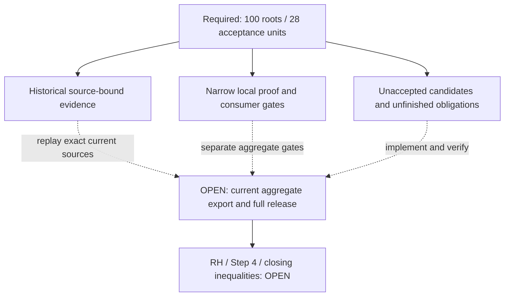
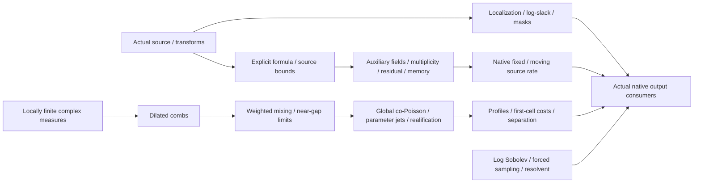

# Manual map: original OPICA follow-up scope

For the whole current programme, read the [README](../../../README.md),
[dated Round 4 snapshot](../../../docs/CURRENT_STATE.md),
[project guide](../../../docs/PROJECT_GUIDE.md) and
[repository/graph map](../../../docs/REPOSITORY_MAP.md).

This file preserves a manual diagram for the original 100-root / 28-unit
follow-up package. Use its [continuation guide](../integration/opica_followup/continuation/2026-10-22/README.md),
[Stage 22 handover](../integration/opica_followup/continuation/2026-10-22/STAGE22_HANDOVER.md)
and [root ledger](../integration/opica_followup/continuation/2026-10-22/ROOT_LEDGER_100.json)
for that scoped checkpoint. Historical/narrow receipts are not full-release acceptance.
The old PR #294 routing below belongs to its date. Its arrows organize work;
they are not compiler dependencies or mathematical implications. RH and Step 4 remain OPEN.

Preserved historical account and checkpoint wording

The dates, counts, active-PR labels and next steps below belong to their original checkpoints.
Use the dated navigation above for the repository-wide reading path.

# OPICA follow-up: agent navigation and current scope

This is a **manual navigation view**, dated 22 October 2026, for
[draft PR #294](https://github.com/HMarcusWH/zeta-23-lean/pull/294).
It is separate from RHKG's generated compiler dependency graph. Its arrows are
route orientation, not `USES_CONSTANT` edges, theorem implications or promotions.
**RH, Step 4 and the independent closing inequalities remain OPEN.**

Start with the [continuation guide](../integration/opica_followup/continuation/2026-10-22/README.md),
[documentation and evidence index](../integration/opica_followup/continuation/2026-10-22/DOCUMENTATION_INDEX.md),
[current root ledger](../integration/opica_followup/continuation/2026-10-22/ROOT_LEDGER_100.json) and [current module status](../integration/opica_followup/continuation/2026-10-22/MODULE_STATUS.md).
Their current-stage handover and exact source receipts govern moving status;
dated checkpoint evidence retains the source and scope it actually checked.
The ledger preserves the original [PUBLIC_ROOTS.json](../integration/opica_followup/PUBLIC_ROOTS.json).
All **100 roots and 28 acceptance units remain required**.

## Read the evidence categories

| Surface | What to inspect | Authority boundary |
|---|---|---|
| Historical evidence | [documentation and evidence index](../integration/opica_followup/continuation/2026-10-22/DOCUMENTATION_INDEX.md) | A receipt applies to its recorded source object. |
| Current local gates | [current root ledger](../integration/opica_followup/continuation/2026-10-22/ROOT_LEDGER_100.json) and [current module status](../integration/opica_followup/continuation/2026-10-22/MODULE_STATUS.md) | A local result does not establish the full required module or package. |
| Unfinished work | [remaining obligations](../integration/opica_followup/continuation/2026-10-22/REMAINING_WORK.md) and [next-agent instructions](../integration/opica_followup/continuation/2026-10-22/NEXT_AGENT_PROMPT.md) | Candidate text and supporting lemmas do not fill absent primary roots. |
| Stage handover | [continuation guide](../integration/opica_followup/continuation/2026-10-22/README.md) | Read exact declarations, source hashes, consumers and retained limitations. |

Current counts and per-root dispositions come from the linked ledger rather
than duplicate numeric labels here. Historical replay, local consumers and this
manual map do not establish current aggregate acceptance or a new registered claim.

## Orient the proof lanes

The following is a status-neutral route map, not a mathematical dependency DAG.
Consult the ledger for each node's actual proved, candidate and open subclauses.

For exact current declarations, imported source refinements and unresolved
physical consumers, follow the [current root ledger](../integration/opica_followup/continuation/2026-10-22/ROOT_LEDGER_100.json), [current module status](../integration/opica_followup/continuation/2026-10-22/MODULE_STATUS.md) and [documentation and evidence index](../integration/opica_followup/continuation/2026-10-22/DOCUMENTATION_INDEX.md).
The [post-green research pass](../integration/opica_followup/continuation/2026-10-22/POST_GREEN_RESEARCH.md)
records implications and falsification checks with their claim labels.

## Keep graph and proof authorities separate

[RHKG build.py](build.py) and [views.py](views.py) produce the deterministic
products under `graph/generated/`. The repository pipeline
[materialize_derived_state.py](../tools/materialize_derived_state.py) refreshes
the registered compiler receipt, graph products and downstream integration views
in dependency order. See the [graph guide](README.md#pr-validation-versus-materialized-snapshots).

Use the existing producer chain for exact graph materialization. Do not edit
generated registry/graph records to insert local results, and do not infer
current compiler dependencies from this page's arrows or module imports.
An exact current-head receipt and the full claim gates are required for any
future aggregate or registration change. Frozen inputs and contracts remain unchanged.

