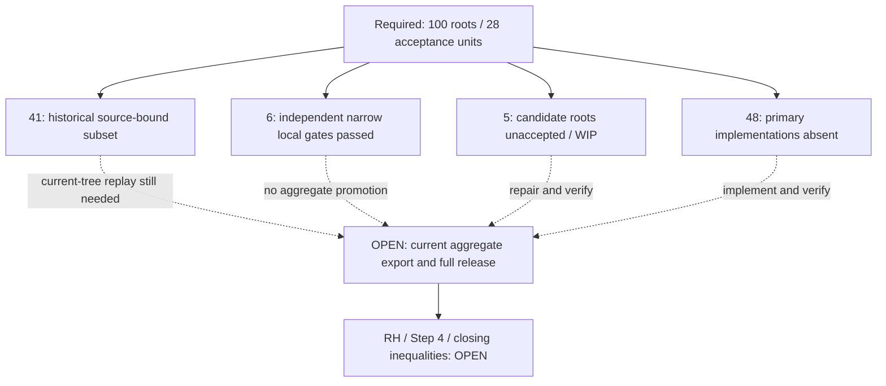
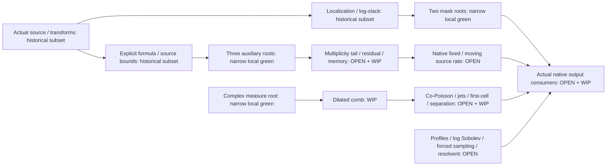

# OPICA follow-up: agent navigation and current scope

This is a **manual navigation view**, dated 22 October 2026, for
[draft PR #294](https://github.com/HMarcusWH/zeta-23-lean/pull/294).
It is separate from RHKG's generated compiler dependency graph. The diagrams
organize obligations and evidence; their arrows are not `USES_CONSTANT` edges,
theorem implications, or claim promotions. **RH, Step 4 and the independent
closing inequalities remain OPEN.**

Start with the [repository continuation guide](../integration/opica_followup/continuation/2026-10-22/README.md)
and the [100-root ledger](../integration/opica_followup/continuation/2026-10-22/ROOT_LEDGER_100.json).
The ledger's embedded contracts preserve the original
[PUBLIC_ROOTS.json](../integration/opica_followup/PUBLIC_ROOTS.json).
All **100 roots and 28 acceptance units remain required**.

## Read the status correctly

| Surface | What the evidence establishes | Where to inspect it |
|---|---|---|
| Historical 41 | A source-bound subset at its recorded historical base; this is not a fresh aggregate receipt for the continuation. | [Historical compiler receipt, gzip](../integration/opica_followup/continuation/2026-10-22/evidence/provided/cold41/subset/compiler-receipt.json.gz) |
| Six repaired roots | Exact module saves, unchanged independent expected-type/domain consumers, and standard-only printed axiom closures for three modules. | [Current independent status and hashes](../integration/opica_followup/continuation/2026-10-22/evidence/current-codex/lean-review/STATUS.json), [review](../integration/opica_followup/continuation/2026-10-22/evidence/current-codex/lean-review/REVIEW.md) |
| Five WIP roots | Preserved candidates that have not passed complete independent acceptance; source presence alone proves nothing. | [Per-root gates](../integration/opica_followup/continuation/2026-10-22/ROOT_LEDGER_100.json), [historical diagnostics](../integration/opica_followup/continuation/2026-10-22/evidence/historical-codex-review/REVIEW_AND_REMAINING_WORK.md) |
| 48 absent roots | Original obligations without complete primary implementations. Some belong to modules that already contain other candidate declarations. | [Remaining work](../integration/opica_followup/continuation/2026-10-22/REMAINING_WORK.md) |

**41 historical plus six narrow local results is not a current 47-root aggregate
acceptance.** The current aggregate source export and full release remain OPEN.
A successful historical replay, local consumer, or documentation graph cannot
change that boundary.

## Find the six locally verified roots

| Module | Locally verified primary declarations | Boundary to retain |
|---|---|---|
| [MaskedNativeRate](../../../Zeta23/OPICAFollowup/MaskedNativeRate.lean) | `log_slack_both_low_masks_subexp`; `log_slack_masked_energy_rate_difference` | Constants precede every horizon and allowed moving palette. Both actual mask realizations survive. The rate difference tends to zero; equality with Theta is not established. |
| [ComplexLocalMeasures](../../../Zeta23/OPICAFollowup/ComplexLocalMeasures.lean) | `complex_local_measure_embedding_faithful` | Genuine locally finite complex measures, compact Euclidean variation, faithful tempered embedding and common-growth convergence. Actual native co-Poisson/jet measures remain separate work. |
| [AuxiliaryCompletions](../../../Zeta23/OPICAFollowup/AuxiliaryCompletions.lean) | `aux_completion_actual_transform`; `aux_completion_uniform_decay`; `aux_completion_ratio_bounds` | Actual beta filter and integer action, endpoint atom, extended convergent transform domain, filled half-point value, and one ratio constant for all k. These do not supply terminal memory or the full native window rate. |

All declarations above have namespace `Zeta23.OPICAFollowup`. Read the
[independent mathematical review](../integration/opica_followup/continuation/2026-10-22/evidence/current-codex/lean-review/SEMANTIC_REVIEW.md)
and [actual import refinements](../integration/opica_followup/continuation/2026-10-22/provenance/MODULE_IMPORT_REFINEMENTS.json)
before changing interfaces. The import record preserves implementation deltas;
global dependency-contract reconciliation remains OPEN.

## Orient the unfinished proof lanes

The following is a route map of work, not an exact mathematical dependency DAG.
Each OPEN box still needs the original full contracts and actual constructors.

Useful next entrypoints are
[MultiplicityTail](../../../Zeta23/OPICAFollowup/MultiplicityTail.lean),
[DilatedComb](../../../Zeta23/OPICAFollowup/DilatedComb.lean),
[RenormalizedCoPoisson](../../../Zeta23/OPICAFollowup/RenormalizedCoPoisson.lean),
[FirstCellCost](../../../Zeta23/OPICAFollowup/FirstCellCost.lean) and
[Consumers](../../../Zeta23/OPICAFollowup/Consumers.lean).
Their five currently recorded WIP roots are respectively `laguerre_tail_norm`,
`dilated_comb_fourier`, `zero_measure_first_cell_sign`,
`first_cell_negative_mass_cost` and `step123_word_jet_consumer`.
That list is not their full required scope: consult the ledger for the other
absent roots in those same modules.

The multiplicity route still requires actual top moments, stable-input control,
finite residuals and terminal memory before J5.2/MS1. The heat route still
requires actual local-measure construction, convergence, parameter jets,
realification and sign/separation arguments. The spectral route and independent
closing inequalities are also unfinished. Choose the next proof using the
[next-agent instructions](../integration/opica_followup/continuation/2026-10-22/NEXT_AGENT_PROMPT.md)
and [post-green research pass](../integration/opica_followup/continuation/2026-10-22/POST_GREEN_RESEARCH.md).

## Keep the graph and proof authorities separate

[RHKG build.py](build.py) and [views.py](views.py) produce the deterministic
products under `graph/generated/`. The repository pipeline
[materialize_derived_state.py](../tools/materialize_derived_state.py) refreshes
the registered compiler receipt, graph products and downstream integration views
in dependency order. See [the graph guide](README.md#pr-validation-versus-materialized-snapshots)
for the distinction between PR validation and checked-in snapshots.

Use that existing producer chain for exact graph materialization. Do not edit
generated registry/graph records to insert the six narrow results, and do not
infer current compiler dependencies from this page's arrows or module imports.
An exact current-head receipt and the full claim gates are required for any
future aggregate or registration change. Frozen input/specification graphs and
the original contracts remain unchanged.
