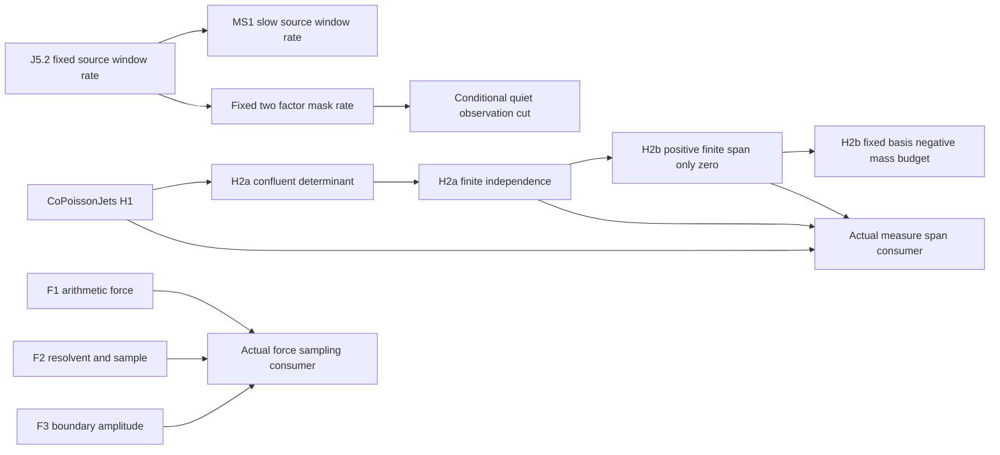

# Stage 19: actual force/sampling composition and post-green research

24 October 2026, Europe/Stockholm. Checked code commit **`59ff485551771c0ab6322562d18fb8e9d4166da4`**, tree **`396665de3d14c2db60a4a85c646dd56d718f07ff`**. This is a source-pinned narrow research report, not full release acceptance.

The record advances the ledger to **41 historical source-bound roots + 50 additional narrow roots + 9 absent original roots**. One original primary is added: `actual_force_sampling_consumer`. The supporting sample-sign, Hermite algebra and rate lemmas are not extra original roots. Paper-unit evidence coverage becomes 21 complete / 5 partial / 2 absent; this is neither aggregate acceptance nor a count of discoveries.

The clean [STATUS](evidence/current-codex/stage19/STATUS.json), [runner](evidence/current-codex/stage19/runner/CHECK_RESULT.json), [negative replay](evidence/current-codex/stage19/NEGATIVE_REPLAY.json) and [workflow consumers](evidence/current-codex/stage19/consumers/CHECK_RESULT.json) pin actual execution. Later documentation or evidence commits must be reconciled separately; their commit hashes were not checked by this compiler receipt.

The programme continues the existing draft PR [294](https://github.com/HMarcusWH/zeta-23-lean/pull/294). The audited intake is commit `cea7b2f62ea847c18958cc7385151c8c2b09520d`, tree `377c7f6f36375a4ac35d3f3ad17ee95b340eb9eb`, branch `research/opica-native-followup`, parent main `d53dd70d38b0762af130b1d19b795af259f505f5`. The supplied handover still matched the live head. The synthetic merge `299c15a432a11c432ff108d6fa864d0f0a428c14` has those two parents and the same tree as the branch head. The PR body contains obsolete Stage 2 counts; it was not used as the progress ledger.

The intake ledger is **41 historical source-subset roots, 49 additional narrow roots, 10 missing original roots; aggregate acceptance FALSE**. RH, Step 4, and independent closing inequalities remain OPEN. A completed supporting consumer, or even an eventual full release, does not change those claims.

## Source authority and preservation

The root AGENTS, Stage 18 handover, original 100-root ledger, BUILD_SPEC, BUILD_MANIFEST, PUBLIC_ROOTS, PAPER_CROSSWALK, PARENT_EXTENSION, audited paper, and stage-record protocol control the work. The user requested their continuation and imposed the no-merge/no-replacement-PR restrictions directly. Archived Drive instructions and proposed patches were treated as historical source material rather than additional authorization. No historical patch was reapplied.

The five supplied Drive folders were inventoried and the controlling OPICA paper, specifications, amendment, parent harvest, archive instructions, and integrity audit were read. Some older snapshots mention 104 roots; the live frozen contract requires 100 roots in 28 units. Read scope, metadata and manuscript comparisons are preserved in the accompanying novelty audit. A main-folder listing hit its 100-item limit; the audit does not claim that every historical binary archive was read recursively.

The protected parent mathematics, five frozen original contract objects, foundational PDFs, existing registered bindings, frozen research data and project `sources/` are preserved. The existing word/jet proof remains in Consumers and is included in the replay. The only validator-pin update is the existing artifact-inventory refresh mechanism; it grants no extra permission or theorem authority. No axiom, proof placeholder, relaxed proof contract, CI exemption, review seal or external approval is introduced.

## The new force and sampling consumer

The production theorem `Zeta23.OPICAFollowup.actual_force_sampling_consumer` uses the draft body in Consumers with the allowed BoundaryAmplitude import. Its full Lean type is independently written out in `consumers/ExpectedForceSampling.lean`.

For an actual zeta zero ρ with `0 < Re ρ < 1` and `Im κ ≠ 0`, κ = ρ(1−ρ), its eleven components are:

1. The log Fourier transform is the ordinary Fourier transform at ξ/(2π).
2. On compact smooth log tests the actual force is the integer log lattice, with weights n^(−1/2), minus exp(t/2) dt. The n=1 atom is retained.
3. The distributional Fourier transform of that force is ζ(1/2+2πiη).
4. The sawtooth transform is −ζ(1/2+iξ)/(1/2+iξ).
5. The actual log-unitary zero profile satisfies the weak forced equation against every Schwartz test.
6. Its log Fourier transform is κζ(1/2+iξ)/(ξ²+1/4−κ).
7. Its ordinary Fourier transform has the correctly rescaled frequency 2πη.
8. The spectral measure is the actual zeta density |ζ(1/2+iξ)|² dξ/(2π).
9. The arithmetic sample defect satisfies `b_sample = κ M(κ)`.
10. The representative σ ∈ {ρ,1−ρ} lies in the right half-strip, is an actual zero, has the same κ, zero boundary amplitude, and the same log profile.
11. No constant multiple of the profile represents its Euler image on all positive-axis tests. The lattice-forced equation is not an eigenvector equation.

The nonreal-κ condition is exactly the F2 domain. The independent physical consumer derives it from `Re ρ ≠ 1/2` and `Im ρ ≠ 0`; it does not assume a zero exists off the line. Definition audits pin κ, both Fourier normalization and exponent, the force, density, sample defect, generic profile, and boundary amplitude. The existing W01 full-type/domain consumer is replayed to test import coexistence.

`b_sample = Σ hρ(n)−1/2` is distinct from `b_norm = (1−2ρ)/κ`, called normalizationBrho in Lean. The generic boundary amplitude is ζ(ρ)/b_norm. Mixing these two quantities would be a mathematical error.

## Supporting sample sign formalization

The sample-sign consumer formalizes a statement already present after (F2.5) in the frozen paper. It does not add a mandatory root or a new discovery count. Write N = ∫|hρ|², Q = ∫x²|hρ′|² and b = b_sample. The actual Gram theorem gives

`Q = κ (N + conjugate b)`.

The log-form identity and N>0 give Q>0. Hence for nonreal κ,

`Im b / Im κ = Q / |κ|² > 0`, and `Im b ≠ 0`.

There is also an explicit conditional corollary: for an actual nonreal strip zero, **if** its arithmetic sample defect is real, then Re ρ=1/2. The reality antecedent remains unproved. The proof uses actual source theorems rather than assuming sample positivity, source regularity or a final desired rate in a packet.

The first scratch attempt failed on two algebraic normalization steps and printed sorryAx as part of Lean's error recovery. That failed output is retained as failure. The corrected proof uses the norm-square expansion and an explicit linear combination of the real and imaginary Gram equations. The final clean compile succeeds with standard axioms only; the failed attempts confer no authority.

## Verification and falsification record

The clean narrow replay reports **PASS_NARROW_ONLY**: 21 modules, 28 independent consumer files, 246 printed transitive axiom closures, all contained in `{propext, Classical.choice, Quot.sound}`. The W04/W07 52 and W06 14 closure checks also pass on the same clean committed source. All commands exit 0; source snapshots are unchanged. Logs, commands and full source hashes are preserved in STATUS and its runner. The build replays inherited linter warnings; a warning-free broad build is not claimed. No `sorry`, `sorryAx` or new project axiom occurs in a successful new closure. The pinned compiler is Lean 4.33.0-rc2 commit d8b18978322de05a8f3dba51ef03cf5461676c17; Mathlib is 51e6992efd06126df61a496bebf8f49482a4e129. Native Windows objects are used only with the native Windows compiler. Toolchain and package pins are unchanged; lake update was not run.

Six contract-mutation controls target the missing Fourier 2π, missing conjugation, wrong reflection κ, missing lattice atoms, arbitrary replacement spectral measure, and a homogeneous eigenproblem. All six are **REJECTED_INTENDED_MUTATION**, nonzero exit, with the intended formula/type error read in the logs; none fails merely from an unknown import. These controls are exact interface checks; rejection of a mutated proof is not a proof that every universally stated mutated formula is false in a possibly empty hypothetical-zero domain.

Separate 60-digit numerical consistency controls use an explicitly nonzero test parameter, not a fabricated off-line zero. The wrong Fourier scaling differs by approximately 2.1771, the missing conjugation by 0.96936, and the wrong reflected conjugation of κ by 1. The correct Plancherel integrands agree to about 8.7e−62. A positive two-dimensional resolvent Gram control has determinant 80 and nonreal parameters. It preserves the counterexample to inferring real parameters from these identities. These are CONSISTENCY_ONLY results.

The first record-phase parent suite rejected an edit to the manual graph page: its seven reviewed documentation files have a separate fixed byte seal. The graph page was restored byte-for-byte to the checked source. No parent validator, review table, protected-state object or test was changed. The failed log is retained, and both complete parent modes pass after the repair (82 tests each, no skips). Both repaired child modes also pass (185 tests each). The frozen replay passes 5112/18862/14672/1274 checks in each mode; its three numerical suites remain CONSISTENCY_ONLY. Current findings remain in this dated report and the moving ledger; the historical manual graph retains its reviewed scope.

## Workflow harvest

The original bounded harvest at 13:50:41 UTC is preserved verbatim. A later [API snapshot](evidence/current-codex/stage19/workflow/LATER_API_SNAPSHOT.json) covers all 22 runs / 66 materialized jobs: **55 success, 6 failure, 4 skipped, 1 running**. The four formerly unmaterialized downstream jobs are now included. Raw logs and parsed results for all 23 newly completed jobs are in the preserved workflow ZIP. At that intermediate snapshot, `source-falsifier-research` in run 40097106328 was running; the final harvest below records its completed outcome. None of these old-head results is CI authority for the new code commit.

Newly completed dispositions include:

| Exact job / scope | Actual result and mathematical disposition |
|---|---|
| PR 120883714346 and push 120885910624, source-subset exporter | `PASS_SOURCE_BOUND_SUBSET_ONLY`, 41 roots / 1379 public declarations / 16 constructors / 7658 dependency nodes; 59 original roots remain outside that exporter. |
| Push 120885910754, narrow replay | Actual push job now passes its own 20-module / 25-consumer evidence; it is not passed by the earlier companion PR result. |
| Push 120885910775, frozen regressions | 185 child and 82 parent tests in both Python modes; finite controls replayed; all numerical suites remain CONSISTENCY_ONLY. |
| Closure campaign formal jobs and campaign-complete | Required conditional theorems replay; summary only coordinates completion. Fast-integrity reports `NO_RH_CLOSURE_ALL_PARALLEL_TRACKS_HARVESTED`. Moving-ground transfer and canonical domination stay OPEN; real-zero matching as limit identification is FALSIFIED; pair visibility requires bulk control. |
| Contact calculus research and completion | 13 tests plus 23 tests in each mode pass. Eleven selected near-contact rows have 8 certified curvature/physical-remainder/response quantities. X01 has `NO_ELIGIBLE_INHERITED_CONTACT`; X02 is a near-contact defect panel with `exact_contact_authority=false`. No theorem promotion. |
| Post268 all eight shards and 44-check harvest | Execution harvest passes with no missing/extra/duplicate result files, explicitly `theorem_promotion=false`. Each check's scientific disposition remains controlling; full RH closure is absent. |
| R003 normalization audit | 88 parsed output blocks preserved, including existing selector scopes and planted off-line controls. This is a replay of existing bounded evidence, not a new OPICA theorem. |

The full nine-item post-green analysis of the earlier bounded harvest remains in [HARVEST.md](evidence/current-codex/stage19/workflow/HARVEST.md).

The final [later harvest](evidence/current-codex/stage19/workflow/LATER_HARVEST.md) completes all **22 runs / 66 jobs: 56 success, 6 failure, 4 skipped, zero pending**. Exact results/steps/source pins/previous comparisons are in its machine-readable companion. The source-falsifier wrapper succeeded but its lower-budget WP4 output was **UNRESOLVED 7/18**, using 500 nodes/600 seconds, while the dedicated job certified 18/18 frozen boxes at 1000 nodes/1200 seconds. These are compatible scoped results, not continuous K3 positivity.

All 44 post268 logs are hash-verified: 43 are byte-identical to the immediately preceding c6ce head; the last changes only a tiny smoke reconstruction residual with the same disposition. Its 32 CHANGED_REVIEW_LOG labels compare an older execution baseline: 30 environment blocks, one missing/failed input and one timeout now execute successfully. They do not denote 32 mathematical discoveries. A contact enclosure improves across zero in one finite row, with unchanged coverage and no eligible inherited-contact authority. Floating eigenvector signs and near-zero row selection vary across executions and are recorded as instability signals. The full scientific dispositions remain controlling.

These completed workflows belong to `cea7b2f6` / tree `377c7f6f`; they confer no exact-new-commit CI authority on `59ff4855` or the later record. All six fail-closed jobs retain their actual failure reasons.

The all-workflow audit retains every run and job, the PR/push event distinction, exact source checkout, comparison head, job steps, logs and scientific outputs. Job success is separated from FORMAL VALIDITY GATE, REGRESSION GATE and RESEARCH-PRODUCING CHECK dispositions. The bounded snapshot explicitly includes queued, running, skipped, cancelled and failed jobs; later timestamps do not retroactively turn a cancellation into a pass.

The old Stage 17 source-falsifier job at c6ce649d, formerly running in its partial snapshot, is now known to have been cancelled. The current native panel's changed hash is explained by changed source commit/tree and elapsed-time fields; its 44 verified numerical pairs and enclosures are unchanged. Eight other scientific outputs inspected against the old run are unchanged. Preserved science includes composite-gap FALSIFIED, later realizability layers UNRESOLVED, indefinite full-space signs, and WP4 K3's 18/18 finite frozen boxes. The boxes do not prove continuous K3 positivity.

Known release failures retain their exact reasons: missing original roots/full100 readiness; unauthorized tracked child deltas under the unextended parent contract; incomplete independent assumption review; and standalone module disposition drift. Dependency extraction is separate from the disposition failure. A successful narrow replay does not accept the parent extension, global registry, canonical graph or full release.

## Compiled supporting work, separately scoped

The immutable [H2 support bundle and audit](evidence/current-codex/stage19/support/h2/MATHEMATICAL_AUDIT_2026-10-24.md) contain generic normalized Hermite algebra, the correct affine sign and κ factors, Hasse/analytic derivative normalization, and the actual first-cell identity. Nine positive compiles and two intended sign/factorial mutation rejections use only standard axioms. Most were checked over the unchanged imported source at the intake head; the final boundary control was checked over `59ff4855`. Per-entry source pins in the receipt take precedence over this summary. They do not complete either H2a primary.

The physical endpoint is a genuine trap: the actual weighted density is zero on the left and generally has a nonzero right slope. A formal countercontrol at κ=1/4 proves it is not differentiable at u=0. H2 coefficients must come from the right-cell analytic formula `κ Sh(1/4−κ,u)`, rather than an ordinary derivative of the two-sided physical density. Generic occurrence-order Hermite columns merge repeated nodes into higher jets; the original profile contract must instead keep each allowed multiplicity block and exclude duplicate spectral nodes. Reflection cannot add a new node. A second immutable [right-cell support audit](evidence/current-codex/stage19/support/h2/right-cell/RIGHT_CELL_H2A_PROGRESS_2026-10-24.md) now closes the analytic bridge and actual distribution injection for cumulative occurrence order: 11 positive jobs and one intended factorial mutation rejection, plus child receipts. It derives normalized κ-jet finite Taylor remainders by a uniform entire-kernel tail and Cauchy estimates; actual measure equality gives first-cell AE density vanishing and arbitrarily small positive exact zeros, forcing all Hermite coefficients to vanish. The independently written consumer proves actual `LinearIndependent ℂ` under the true strip/zero/multiplicity conditions. Exact imported source hashes and the dirty documentation worktree are recorded. This remains supporting authority: the original canonical grouped `(j,k)` matrix and product powers must still be connected before either H2a root can be promoted.

The [rate support report](evidence/current-codex/stage19/support/rate/POST_GREEN_RATE_REPORT_2026-10-24.md) and two sealed receipts prove supporting results for the actual field, without a final-rate premise. The first bundle has six successful jobs / 30 closure audits; the second has five / 16. All closures are standard-only, exact source/import hashes are recorded, and none is counted as J5.2 or MS1.

- Under the unchanged MS1 condition `d(T) log(d(T)+2)/T → 0`, actual source-factor, multiplicity-tail and envelope logarithmic costs are subexponential, including d=0.
- The actual completion index `max(1,⌊ξT/log T⌋)` has damping cost tending to ξ and a sufficient upper auxiliary cost bound.
- The literal final-window energy has its full upper rate bound; Θ=0 is complete using nonnegativity.
- The actual completed input eventually survives subtraction by half its lower coefficient. This is proved from original MS1 and actual source constants.
- A finite-horizon barrier is proved for the actual window: `max(L−O,0)^2 ≤ C log(T) E`, where L is the A6 lower term after actual input subtraction and O is the old-memory upper bound. It is positive only when L>O. A Lean control explicitly proves that it vanishes when the subtraction dominates.

Further asymptotic lower-bound work is ongoing outside these sealed bundles and has no authority in this stage. A later independently checked stage must complete strict signal/old-memory separation and the original supremum/limit adapters before either rate root is promoted.

## Dependency order and unresolved work

The original remaining graph has two main lanes and the force composition:

H2a requires the normalized Hermite matrix with columns `(j,k)` and entries `(1/k!) ∂κ^k[κ(1/4−κ)^n]`. Its determinant is the frozen sign times `∏κj^mj ∏i<j(κj−κi)^(mi mj)`. Reflection ρ↦1−ρ is one node. A generic determinant alone is insufficient until the actual first-cell jet data and normalized derivatives are identified. Finite independence must use the actual profile/measure functions.

H2b must construct every actual realified signed-measure combination, discharge the parent separator's order-zero, growth, gap, self-duality and off-lattice sign premises, and use the coefficient/measure injection for its zero conclusion. Compactness yields a constant for each fixed basis. It does not supply a uniform constant over coalescing or growing bases.

J5.2's existing A6/A8 estimates have the required uniformity for the auxiliary order. The apparent pointwise-versus-eventual concern was checked against the full proofs and withdrawn. Remaining Lean obligations include floor/log asymptotics, source-factor logarithmic cost, subtraction stability, the old-memory/window split and both rate bounds. MS1 needs its own uniform slow-source control; fixed-d theorems alone do not justify an unbounded diagonal substitution. Both retain d=0, every C>1, zero multiplicity and Θ=0. The quiet-observation cut remains conditional and supplies no quiet observation.

## Novelty assessment

The accompanying novelty audit recomputes the post-#284 inventory and compares 16 mathematical themes with published primary literature. The intake contained 94 new registry identifiers plus 90 distinct child roots (184 statement identifiers). Stage 19 adds one child primary, giving 185 identified statements; neither number is a count of discoveries. The existing 17-paper corpus is reconstructed from 16 manuscript bodies; the missing body is Moment–Jet Rigidity and Exact Riesz Boundary Recurrences. No worldwide priority claim has been independently confirmed.

Burnol already has multiplicity-sensitive zero evaluators and complete/minimal systems; Hermite/Vandermonde determinants and compactness are classical. The source-normalized measure realization, precise domains, arithmetic boundary functional, finite-span sign restriction and scoped square obstruction are the narrower comparison targets. Published Fourier eigenmeasures with large central gaps falsify a gap-plus-self-duality exclusion without the additional sign premises. The raw-sample sign and force consumer are known consequences once the source identities are proved. Priority candidates remain candidates pending exact-statement specialist review.

Published primary comparisons include [Burnol 2004, multiplicity-sensitive zero evaluators](https://www.numdam.org/articles/10.5802/jtnb.434/), [Burnol 2007, co-Poisson intertwining](https://www.numdam.org/item/AIF_2007__57_2_525_0/), [Gautschi 1962, confluent Vandermonde inverses](https://www.cs.purdue.edu/homes/wxg/selected_works/section_01/016.pdf), and [Baake–Spindeler–Strungaru 2023, Fourier eigenmeasures with large gaps](https://link.springer.com/article/10.1007/s00041-023-10045-z). They support classical-mechanism and falsification classifications, not exact worldwide-priority claims. The detailed [novelty/Drive audit](evidence/current-codex/stage19/novelty/OPICA_NOVELTY_AND_DRIVE_AUDIT_2026-10-24.md) retains exact comparison limits.

## Post Green Research Pass

1. **What became formally true.** Read the exact successful source receipt. The force consumer is an end-to-end composition, not a stronger zero exclusion. The supporting raw-sample sign formalizes an existing paper consequence. The independently compiled normalized-jet block lemmas are supporting algebra, not either original H2a root.
2. **Workflow harvest.** Exact dispositions and comparisons are preserved as above and in the machine-readable harvest. The older cancelled source job and the later completed wrapper with partial mathematical output remain explicit. No full-green PR claim is made.
3. **What changed.** The actual source/force/transform/sample/boundary interfaces now have a verified independent consumer and regression coverage with W01. This one primary completes narrow evidence coverage for four paper families F1/F2/F3/S1b, not four discoveries.
4. **Upstream implications.** The same forced resolvent and Gram equation give both the sign of M=b/κ and the sign of b. The latter is the a-weighted Stieltjes kernel, already underlying the Euler Gram form. A common canonical algebra lemma could compress these proofs; neither positivity is an extra arithmetic assumption.
5. **Downstream implications.** A genuine independent restriction on the same sample would be useful. The raw sign tells exactly what a hypothetical off-line zero must satisfy. The finite-span lane could prohibit positive linear repairs when all signed-measure premises are actually supplied. Source-specific distortion bounds would be needed to extend a fixed-basis obstruction to growing families.
6. **Resurrected routes.** The F1–F3 integration draft is now executable against the current rebuilt source. The homogeneous self-adjoint route, Gram-positivity route, square/lattice repair and unrestricted C3 bound retain their previous failure reasons. No old failed RH route is declared revived by interface completion.
7. **New RH-relevant clues.** **PROVED (narrow, receipt-backed):** the raw-sample sign. **DERIVED:** it is the Herglotz positivity of κM and is equivalent to existing form positivity in this setting. **LEAD:** seek an independent native bound on the same sample or a quantitative fixed-span distortion estimate. **OPEN:** such an independent restriction and any resulting zero exclusion. There is no new RH proof.
8. **Falsification checks.** Real forcing and a positive spectral density do not make b real: the finite nonreal resolvent control disproves that inference. Keep κ/(a−κ) as one convergent kernel; ω need not have finite total mass, so splitting it into separately divergent terms is invalid. κ=0 and repeated nodes kill determinant invertibility. Coalescence makes inverse conditioning degenerate. Exact factorial/sign tests include the empty determinant and higher multiplicities. No synthetic example is presented as an actual zeta-zero configuration.
9. **Highest-leverage next moves.** Finish the general normalized confluent determinant and its first-cell bridge, then actual finite independence and the realified separator. Test any proposed uniform negative-mass constant against node collision before using it in a varying family. In parallel, build the precise J5.2 window split; distinguish its zero-signature detection from an independent upper restriction. Keep full100 cold replay, parent extension, canonical generation, registration, independent review and exact-head complete workflow harvest separate.

## Still OPEN

- Original roots: `profile_jet_confluent_determinant`, `finite_zero_jet_independent`, `finite_zero_span_positive_only_zero`, `fixed_basis_negative_mass_budget`, `actual_zero_measure_span_consumer`, `native_fixed_source_window_rate`, `native_slow_source_window_rate`, `fixed_two_factor_mask_rate_theta`, `quiet_balanced_observation_implies_native_cut`.
- Aggregate current-source full100 compiler receipt and cold replay; parent extension; registry/dependency validation; canonical graph regeneration; genuine independent reviews and release seal.
- Exact-new-head workflow harvest after push. The old cea7 head is fully harvested; its results do not pass later source commits. Pending new-head work is not a pass.
- Independent sample-reality or other closing restriction; unconditional quiet observation; uniform growing-basis conditioning; complete 17-manuscript priority comparison.
- **RH OPEN. Step 4 OPEN. Independent closing inequalities OPEN.**
